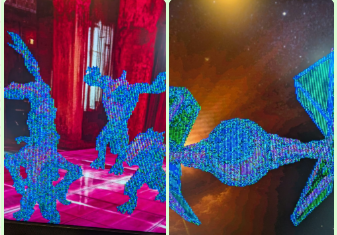
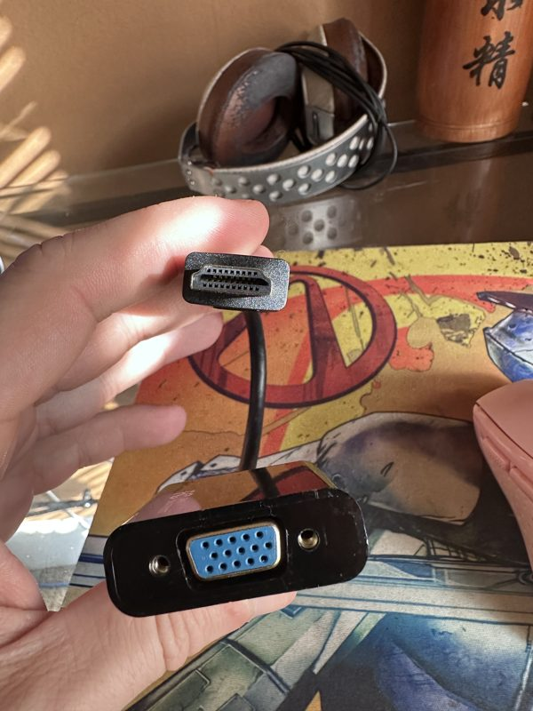

# #a6000 — Week 43, 2026 (Oct 19 – Oct 25, 2026)

> **TL;DR** — A6000 users discussed WHDLoad 20.1.7190 failing with a display error, VGA monitor hookups, and CF vs SD boot options. Maggie demos rendered wrongly on beta core 12556; biggun68080 said the next beta core fixes it.

## Top topics

### Maggie demos broken on A6000 beta core 12556; fix coming in next beta
horatiusmarcellus saw Maggie demos render wrongly on a new A6000 running beta core 12556; biggun68080 said a driver hiccup in the beta core is fixed for the next beta.

- rmortenb said a format selection problem affected some beta cores, with registers unchanged as far as known.
- biggun68080 said TuKo fixed the driver hiccup.
- crom6028 advised waiting for the next core rather than reflashing.

❓ **Open:** Next beta core release date not given.

_horatiusmarcellus, biggun68080, kamelito, crom6028 · [jump →](https://discord.com/channels/726870908568076380/1417931629510266971/1563254031831404705)_

### WHDLoad 20.1.7190 fails with 'Couldn't find UCL instruction' display error
amy.r.whiting hit a display initialisation error with the latest WHDLoad; kamelito called it a known issue and advised going back to version 19.

- kamelito said things changed in version 20.
- danyppc reported no problems with WHDLoad 20.1 on an A6000.
- amy.r.whiting suspects it relates to SAGA and displays.

_amy.r.whiting, kamelito, danyppc · [jump →](https://discord.com/channels/726870908568076380/1417931629510266971/1562514513448800266)_

### Connecting a VGA monitor to the A6000 via HDMI adapters
anti_cmos asked about VGA output; biggun68080 said passive HDMI-to-VGA adapters do not exist, and 1024x768 failed while 800x600 worked, with refresh rate suspected.

- biggun68080: such adapters must contain active electronics; DVI-to-VGA is another option.
- anti_cmos's monitor only accepts 60Hz and works at 800x600x32 but not 1024x768.
- thedaemonofid uses a box or HDMI-to-HDMI adapter that normalizes refresh rate.

🔗 [Cuxnoo HDMI to VGA Adapter with 3.5mm Audio](https://www.amazon.com/Cuxnoo-Converter-Raspberry-Chromebook-Projector/dp/B0886126Z4?c=ts&dib=eyJ2IjoiMSJ9.deqhWE7jJFW00a_PfUUcv6aNClrrTz4KdMgjdKxP6N-abFjZze8Y1kjisQAxLDmvxPgek86FY3OiOSlvaPSHSHKK4_oF4x9u9tJVFe2LqP4GN6AYzkAB5jeK3h4__tKLdRNo0tbIrgmyq4p8Kx2kFWBf3rt7lj3CBMfaa6FOohakP4tOP4z1taP1nErNc6pgatpoXHYfMGDh_FGS2VqB4pgctxBfiCIDFyQRx9ZiLz13naSVulvRewTp-WNGfG7BEAtajKSer6JrDjkUmEPRMsYz8KjZa1wLlQpvVuoMamk.wKtooTgBmISjQkrtQoNcrK5WzJzIe1-nc75grP6CW7s&dib_tag=se&keywords=HDMI-to-VGA+Adapters&qid=1792678922&s=pc&sr=1-23&ts_id=14570285011)

_anti_cmos, thedaemonofid, biggun68080, colpire · [jump →](https://discord.com/channels/726870908568076380/1417931629510266971/1562818489041952809)_

## Also this week

- A6000 CF vs SD boot option; storage prices rising · [jump →](https://discord.com/channels/726870908568076380/1417931629510266971/1563165427872309319)
- SD0 and SD1 suddenly write protected on A6000 · [jump →](https://discord.com/channels/726870908568076380/1417931629510266971/1563970004725010647)

---
_Generated 2026-10-26 from 59 messages._
