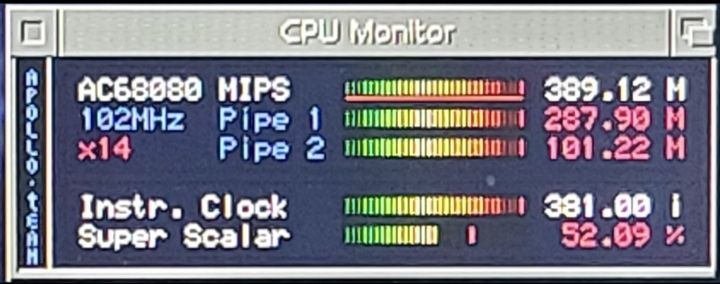

# #a6000 — Week 44, 2026 (Oct 26 – Nov 01, 2026)

> **TL;DR** — MIDI on the A6000 dominated the week: the interface is on the roadmap with no timeline, and users debated serial-to-MIDI adapters and baud rates. Also covered: HRTmon debugger, a stable 12556 core with LightWave rendering, and the A6000 keyboard.

## Top topics

### MIDI on A6000/V4SA: roadmap only, community debates serial adapters and baud rates
willemdrijver said an A6000 MIDI interface is on the roadmap with no timeline; users explored serial-to-MIDI adapters, level shifters and which baud rate to support.

- A6000 exposes serial/TTL signals internally but there is no adapter yet; the V4 Ultimate Expansion Board has a mini-MIDI connector.
- MIDI standard is 31.25 kbaud; nihirash found many MIDI devices accept nothing else, though others cited 38800 and 115200 usage.
- blast666 shared a PCBWay Amiga serial MIDI adapter; veneficvs noted it runs at 5V and would need adapting for V4SA.

❓ **Open:** No MIDI interface timeline for A6000 or V4SA; a working adapter setup is still needed.

🔗 [V4 Ultimate Board](https://www.jakeandpeppy.com/v4ultimateboard) · 🔗 [MIDI RS232 Interface with USB and DIN5 1x1 I/O](https://www.tindie.com/products/deftaudio/midi-rs232-interface-with-usb-and-din5-1x1-io/) · 🔗 [Amiga Serial Midi Adapter v1.3 - PCBWay](https://www.pcbway.com/project/shareproject/Amiga_Serial_Midi_Adapter_v1_0_d6b9ad10.html) · 🔗 [SparkFun Logic Level Converter - Bi-Directional](https://www.sparkfun.com/sparkfun-logic-level-converter-bi-directional.html) · 🔗 [RealTerm: Serial/TCP Terminal](https://sourceforge.net/projects/realterm/) · 🔗 [gusmanb/logicanalyzer](https://github.com/gusmanb/logicanalyzer) · 🔗 [ca33 5 PIn DIN Electrical Spec.pdf](https://drive.google.com/file/d/1L2YHBOZdSCuMg-RFR3TTEJcdV6KWkLZ9/view?usp=drive_link)

_veneficvs, blast666, neb_le_mans, willemdrijver · [jump →](https://discord.com/channels/726870908568076380/1417931629510266971/1564887025591787561)_

### Core 12556 reported stable on V4 during week-long LightWave renders
asktodd runs core 12556 at 100MHz on a V4 Ultimate and rendered LightWave animations for a week without crashing, showing 160-480 MIPS peaks.

- asktodd uses LightwaveRTG; biggun68080 said code using the pipelined FPU could be about 5 times faster.

_asktodd, biggun68080, thedaemonofid · [jump →](https://discord.com/channels/726870908568076380/1417931629510266971/1564723386092097671)_

### Integrated debugger is HRTMon; A6000 keyboard is USB but register-compatible
kamelito said the debugger is HRTMon and pointed to its guide; tjomp said the A6000 keyboard is USB but looks like other Amigas to software.

🔗 [hrtmon/HRTmon.guide at master · wepl/hrtmon](https://github.com/wepl/hrtmon/blob/master/HRTmon.guide)

_kamelito, tjomp, r3dbug · [jump →](https://discord.com/channels/726870908568076380/1417931629510266971/1564612980736393338)_

## Also this week

- themkat reports DB9 mouse stuck in corner on A6000 · [jump →](https://discord.com/channels/726870908568076380/1417931629510266971/1565117311772401845)
- Gunnar's laptop broke; replies delayed · [jump →](https://discord.com/channels/726870908568076380/1417931629510266971/1565806966901710919)

---
_Generated 2026-11-02 from 101 messages._
