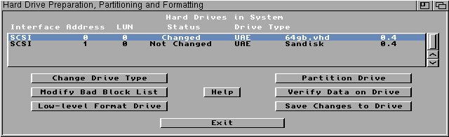

# #apolloboot — Week 41, 2026 (Oct 05 – Oct 11, 2026)

> **TL;DR** — michael_1260 got a dual-CF master/slave setup working on a VS4 Standalone with willemdrijver's help, settling on ID=2 with two identical SanDisk Extreme cards. awakeningstar's AmiKit XE install still hangs on AOS39.

## Top topics

### Two CF cards in master/slave on VS4 Standalone working with ID=2 and matching SanDisk cards
michael_1260 set up two CF cards on a VS4 Standalone via a dual-CF IDE adapter; after a Kingston slave failed, two SanDisk Extreme cards with ID=2 worked.

- willemdrijver confirmed Fast-IDE and ata.device/scsi.device support master/slave; ID=3 needs both devices to support PIO mode 6, ID=0 for ATAPI.
- A Kingston slave caused boot errors and a corrupted system; willemdrijver said Kingston works poorly in master/slave and advised identical CFs.
- With two SanDisk Extreme cards the slave showed in HDToolBox as SCSI 1; it was then partitioned and formatted. ID=3 is maybe pushing the limits, so ID=2 stays.

🔗 [Bootable 2.5" IDE to CompactFlash Adapter with 2 CF Slots](https://www.inline-info.com/en/InLine-IDE-2.5-Drive-to-2x-Compact-Flash-Adapter-use-CF-cards-as-hard-disks)

_michael_1260, willemdrijver · [jump →](https://discord.com/channels/726870908568076380/836274852720541757/1557464531364614316)_

### awakeningstar's AmiKit XE install still hangs on AOS39 in FS-UAE
awakeningstar tried AOS39 as hansolo9190 suggested, but the install hangs the same way; hansolo9190 advised redownloading everything or using PRELOAD.

- awakeningstar uses an img file mounted in FS-UAE, not a CF card.
- hansolo9190 suggested deleting all files and redownloading everything including ApolloBoot.

_awakeningstar, hansolo9190 · [jump →](https://discord.com/channels/726870908568076380/836274852720541757/1557464531364614316)_

---
_Generated 2026-10-12 from 48 messages._
