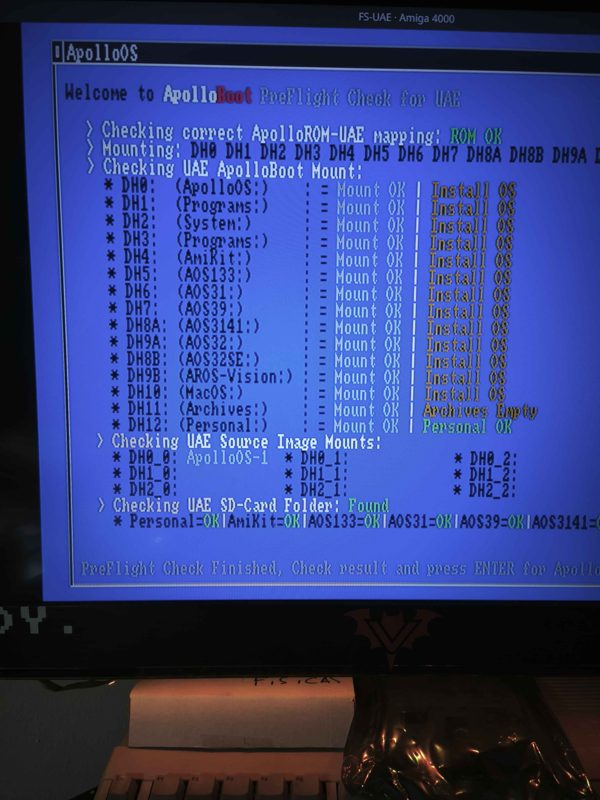

# #apolloboot — Week 42, 2026 (Oct 12 – Oct 18, 2026)

> **TL;DR** — Willem announced the ApolloBoot OMNI R93 update is delayed due to installer framework issues, with tighter UAE integration planned and R10 on the roadmap. Meanwhile maia75000 worked through several install failures, eventually traced to a corrupted OS3.2 ISO and FS-UAE on Arch Linux.

## Top topics

### ApolloBoot OMNI R93 delayed; UAE front-end and booting planned, Willem on holiday
willemdrijver said R93 can't ship this week because the new OS installer framework still has bugs; tighter UAE integration is done, and work resumes in late November after a holiday.

- Planned UAE front-end will simplify OS installation; UAE will also be able to boot installed OSes for testing and repairs.
- ApolloBoot R10 (no ETA) will add a pre-install file-finding script, OS switching in UAE, and mounting the CF/SD card in UAE.
- clayntexas reported the ApolloBoot menu vanishes after pressing ENTER in the preflight when running R93 in UAE.

❓ **Open:** clayntexas's R93 menu-vanishing problem got no answer this week.

_willemdrijver, reaperx2637, clayntexas · [jump →](https://discord.com/channels/726870908568076380/836274852720541757/1560211893749022772)_

### maia75000 troubleshoots ApolloBoot installs; corrupt ISO and FS-UAE on Arch Linux found
maia75000 hit boot errors and bad ApolloOS image mounts, fixed the image via Windows decompression, then found a corrupted OS3.2 ISO and misbehaving FS-UAE on Arch Linux as the causes of failed installs.

- Recovery from the iffparse.library error: boot DH99 without startup-sequence, run `ab-recover`, then pick ApolloOS in the ApolloBoot Menu.
- Image mounts should show ApolloOS-1 on DH0_0 and ApolloOS-2 on DH1_0; decompression on Windows fixed it.
- Fix: re-download the OS3.2 ISO from the Hyperion profile and run the process on Windows; be careful with FS-UAE and Balena Etcher on Arch Linux.

🔗 [Apollo Computer downloads](https://www.apollo-computer.com/downloads.php#OS) · 🔗 [Google Drive file shared by willemdrijver](https://drive.google.com/file/d/1hgn9qzdhGy7LC8r-9NQxJyKc40obS8YB/view?usp=share_link)

_maia75000, willemdrijver, morten.dynamite, mikohelsing · [jump →](https://discord.com/channels/726870908568076380/836274852720541757/1559495567158157325)_

### ApolloBoot explained; users share OMNI and Trio install experiences
tim3233 explained ApolloOS doesn't need ApolloBoot, which targets running AmigaOS or multiple OSes; amigoray and awakeningstar reported their Trio and OMNI installs.

- ApolloBoot maps the OS-appropriate Kickstart ROM, per tim3233.
- awakeningstar installed OMNI after 3 weeks but AmigaOS 3.2.3 upgrade failed in AmiKitxe.
- jorpoli asked which systems the new Omniboot will include; olafsch. said Aros Vision should be.

❓ **Open:** awakeningstar's AmigaOS-3.2.3.lha upgrade problem remained unanswered.

_tim3233, amigoray, awakeningstar, jorpoli · [jump →](https://discord.com/channels/726870908568076380/836274852720541757/1560326697973452901)_

---
_Generated 2026-10-19 from 61 messages._
