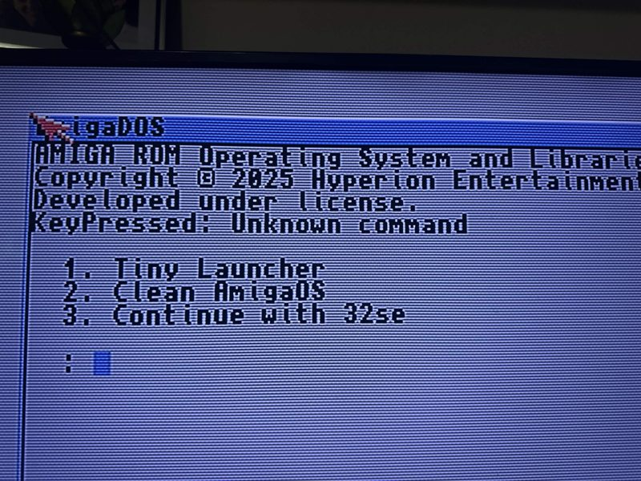

# #apolloboot — Week 43, 2026 (Oct 19 – Oct 25, 2026)

> **TL;DR** — awakeningstar set up ApolloBoot on an A6000 and hit problems with AmigaSE boot and network driver choice; the `ab-recover` procedure got them back to the menu. willemdrijver's ApolloBoot R93 update is delayed until after 9 November.

## Top topics

### AmigaSE boot hangs on A6000; `ab-recover` restores ApolloBoot menu
awakeningstar's AmigaSE selection left the A6000 stuck in a non-working boot screen; thedaemonofid and tim3233 gave the recovery steps, which worked.

- Only the tiny launcher option worked; the other two did nothing. Previously awakeningstar had to reflash the CF card.
- Recovery: hold both mouse buttons at power on, choose Boot without startup-sequence, type `DH99:` then `execute ab-recover`.
- After recovery from AROS Vision, awakeningstar got an error choosing Magellan workbench.

📎 [`IMG_2042.mov` (3.2 MB)](https://discord.com/channels/726870908568076380/836274852720541757/1562834750782308492)

_awakeningstar, thedaemonofid, tim3233 · [jump →](https://discord.com/channels/726870908568076380/836274852720541757/1562455666289934417)_

### Amikitxe first-run network driver choice on A6000
awakeningstar asked which network driver to pick; biggun68080 said SDnet is wrong for the A6000, while willemdrijver said ApolloBoot sets the correct network settings.

- awakeningstar selected sdnet and the network came online.
- awakeningstar plans to select none next time to see what happens.

_awakeningstar, biggun68080, willemdrijver · [jump →](https://discord.com/channels/726870908568076380/836274852720541757/1562170697403338753)_

### ApolloBoot R93 update delayed until after 9 November
willemdrijver could not finish ApolloBoot R93 before their holiday and will continue after returning on 9 November.

❓ **Open:** R93 release is pending willemdrijver's return on 9 November.

_willemdrijver, kiasanth · [jump →](https://discord.com/channels/726870908568076380/836274852720541757/1563931548548603947)_

## Also this week

- ApolloBoot SOLO on V2 and v4sa SD card questions answered · [jump →](https://discord.com/channels/726870908568076380/836274852720541757/1562684361701072960)
- Installing AtariOS: biggun68080 recommends a clean Atari machine · [jump →](https://discord.com/channels/726870908568076380/836274852720541757/1562935414975631381)

---
_Generated 2026-10-26 from 33 messages._
