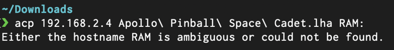

# #apolloboot — Week 47, 2026 (Nov 16 – Nov 22, 2026)

> **TL;DR** — Apollo team clarified the upcoming real Atari core versus the Amiga core on V4 Standalone, and r3dbug explained SD boot needs newer ROM/core (12856+). ApolloExplorer crashes on macOS 27.2.1; a codesign workaround helps only briefly.

## Top topics

### ApolloExplorer crashes on macOS 27.2.1; codesign rebuild workaround is only temporary
eriktier and michael_1260 confirmed ApolloExplorer.app crashes on macOS 27.2.1; willemdrijver will investigate, while the terminal `acp` command still works for copying files.

- michael_1260 reported the crash on M1, M4Pro and M5 Macs; rebuilding with the script then running `sudo codesign --force --deep --sign - /Applications/ApolloExplorer.app` fixed it.
- For eriktier the app crashed again after running in the background.
- Working copy syntax: `acp Apollo\ Pinball\ Space\ Cadet.lha 192.168.2.4:RAM`; the earlier error concerned the hostname.

_eriktier, michael_1260, willemdrijver · [jump →](https://discord.com/channels/726870908568076380/836274852720541757/1573684141445226579)_

### Booting from SD needs newer ROM/core 12856+, not official release 11350
r3dbug explained SD boot depends on the ROM and arrived around cores 125xx, so clayntexas on 11350 lacks it; r3dbug recommends core 12856 as stable.

- Core 11350 only has `sd0:` via an sd0 file in `DEVS:DOSDrivers`, which had to be mounted/unmounted.
- With 12856, sdromx automounts; delete the sd0 file in `DEVS:DOSDrivers`.
- clayntexas reports SDROM0 and sd0 don't work with TRIO Preload on Apollo, Coffin or AOS3.2.3, but do with OMNI Preload except Apollo.

_clayntexas, r3dbug, kamelito · [jump →](https://discord.com/channels/726870908568076380/836274852720541757/1572133423944835083)_

### biggun68080 explains real Atari core versus Amiga core on V4 Standalone
After AtariOS for ApolloBoot was discontinued, biggun68080 said V4 SA can run either a full Amiga core or a full Atari core with genuine Atari chipset and memory map.

- Atari and Amiga share the CPU but differ in chipsets and memory layout.
- The Atari core implements Yamaha audio, Atari Shifter GFX, keyboard controller and timers, and plays original Atari games.

_biggun68080, .winnowing · [jump →](https://discord.com/channels/726870908568076380/836274852720541757/1571915199001141350)_

## Also this week

- lordmdra asks about enhanced 1.3.4 install progress · [jump →](https://discord.com/channels/726870908568076380/836274852720541757/1573628672877797491)

---
_Generated 2026-11-23 from 49 messages._
