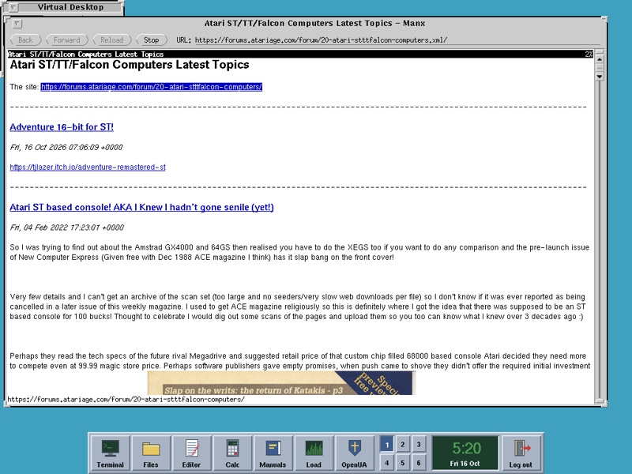

# #atari — Week 42, 2026 (Oct 12 – Oct 18, 2026)

> **TL;DR** — Atari/Amiga talk: angelofspectral said new Atari cores are being compiled. Long debate on MMU/virtual memory versus DMA, with MiNT as a use case. Also gcc versions for 68k, and Rajah_19927's HighWire fork with SSL/TLS.

## Top topics

### Atari FPGA core: new cores being compiled, one expected soon
souldreamfr asked about the status of the latest Atari core and a planned new card; angelofspectral replied that cores for Atari are being compiled and a good one should come soon.

- souldreamfr noted the Falcon core is appearing on MiSTer FPGA.

_souldreamfr, angelofspectral · [jump →](https://discord.com/channels/726870908568076380/858224790808821760/1559986117862887485)_

### MMU and virtual memory versus Amiga DMA, and MiNT as use case
biggun68080 argued that Unix-style virtual memory breaks DMA and that MiNT, with virtual address equal to physical, is the better MMU use case; slaapliedje discussed Amix on A1200/A4000.

- biggun68080: Unix needs MOVES and MMU table switches to copy between programs, which is slow and complex.
- blast666 recalled MiNT virtual memory support; lonnypursell and kimchipenguin. cited the Outside add-on and VRAM030.
- biggun68080 sees fragmentation prevention as the main virtual memory benefit for 24/7 servers.

📎 [`How_AMIX_handles_DMA_alongside_the_MMU.txt` (2 KB)](https://discord.com/channels/726870908568076380/858224790808821760/1560750646850748416) · 🔗 [Outside und VRAM030 (ST-Magazin 1992/04)](https://www.stcarchiv.de/st-magazin/1992/04/outside-und-vram)

_biggun68080, slaapliedje, blast666, ol4865 · [jump →](https://discord.com/channels/726870908568076380/858224790808821760/1560737080060158135)_

### gcc versions for 68k: gcc 12 vs gcc 4 warnings, code quality
rajah_19927 hit extra warnings and errors in gcc 12.4 compared with gcc 4 on a HighWire fork adding SSL/TLS; ol4865 compared code generation across gcc versions.

- Neil's HighWire builds with gcc 4.6.4 in atarist-toolkit-docker; rajah_19927 uses gcc 12.
- ol4865: modern gcc is worse on simple loops and block copies than gcc 2.95.3, but better on CoreMark.
- biggun68080 and ol4865 called CoreMark a poor computer benchmark.

🔗 [Rajah's HighWire SSL/TLS fork post](https://m.g3l.org/@Rajah/117435964387713110) · 🔗 [m68k-atari-mint-cross-tools](https://github.com/pd95/m68k-atari-mint-cross-tools) · 🔗 [Atari cross compiler article](https://xn--donz-epa.ch/atari/articles/cross-compiler/)

_rajah_19927, ol4865, slaapliedje, biggun68080 · [jump →](https://discord.com/channels/726870908568076380/858224790808821760/1559697325041918022)_

---
_Generated 2026-10-19 from 153 messages._
