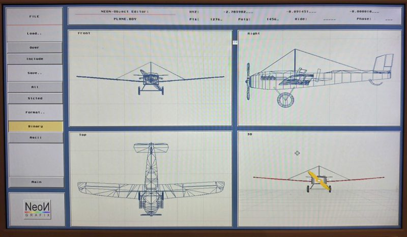

# #atari — Week 44, 2026 (Oct 26 – Nov 01, 2026)

> **TL;DR** — tjomp released a 68080-capable Devpac editor and Gen assembler for Atari, with a debugger planned. NeoN 3D Grafix 1.3 was shown on Vampire, a Falcon vs V4 speed comparison was posted, and cjf077 got help booting Atari TOS on an Apollo A6000.

## Top topics

### 📦 tjomp releases 68080-capable Devpac editor and Gen assembler for Atari
tjomp shared an updated Devpac editor and Gen assembler with 68080 support for Atari clones, with a Mon debugger planned once a 68080 Atari core is available for testing.

- Gen is much faster than vasm and supports new instructions coming in the next core that vasm lacks.
- Code is shared with Tommo on Github; vasm lags behind core changes and lacks good debug info for tjomp.
- kamelito pointed to a makedebug script in code already sent to tjomp that adds debug info to vasm executables; tjomp will check it.

❓ **Open:** Mon debugger for Atari still needs a 68080 Atari core for testing.

📎 [`devpac.prg` (91 KB)](https://discord.com/channels/726870908568076380/858224790808821760/1566507806243160186) · 📎 [`gen.ttp` (77 KB)](https://discord.com/channels/726870908568076380/858224790808821760/1566507806243160186)

_tjomp, tommo8871, blast666, lonnypursell · [jump →](https://discord.com/channels/726870908568076380/858224790808821760/1566507806243160186)_

### NeoN 3D Grafix 1.3 on Vampire; font and AES compatibility issues
blast666 showed NeoN running on Vampire, now also working on Atari clones; lonnypursell tested its document processor and found font problems across AES environments.

- lonnypursell reported missing fonts, non-scrolling popups, but useful PDF export.
- EdWord works better with NVDI than fVDI, per blast666.
- Latest MyAES fails the font test and renders the system font instead; ol4865 asked what software was affected.

🔗 [NeoN 3D Grafix 1.3 released](https://atariscne.org/news/index.php/neon-3d-grafix-1-3-released)

_blast666, lonnypursell, ol4865 · [jump →](https://discord.com/channels/726870908568076380/858224790808821760/1564344793750966282)_

### Running Atari TOS natively on Apollo A6000 with EmuTOS
cjf077 asked how to run Atari ST games natively on an A6000; they found the TOS menu in OmniBoot and switched it to English, and others suggested floppy image tools.

- slaapliedje pointed to an Atari floppy image runner page but was unsure it works on the A6000.
- ol4865 said the core ships with EmuTOS, only one multilanguage version.
- ld2302_98848 suggested Castaway/Atari, which runs on the Amiga core on V4SA.

🔗 [Atari hard drive image page](https://atari.8bitchip.info/fromhd.php) · 🔗 [Image runner](https://atari.8bitchip.info/imgrun.php)

_cjf077, slaapliedje, ol4865, ld2302_98848 · [jump →](https://discord.com/channels/726870908568076380/858224790808821760/1564183468173172852)_

## Also this week

- Falcon vs V4 speed comparison shows big speedup · [jump →](https://discord.com/channels/726870908568076380/858224790808821760/1566500551892406283)
- DSP need for Atari clones: non-DSP Falcon ports on V4 · 🔗 [Atari-forum reply from Anima](https://www.atari-forum.com/viewtopic.php?p=503222#p503222) · 🔗 [Street Fighter II' Champion Edition on the Atari Falcon (68060)](https://www.youtube.com/watch?v=H4nFBn4CK1Q) · [jump →](https://discord.com/channels/726870908568076380/858224790808821760/1564732832906092658)

---
_Generated 2026-11-02 from 70 messages._
