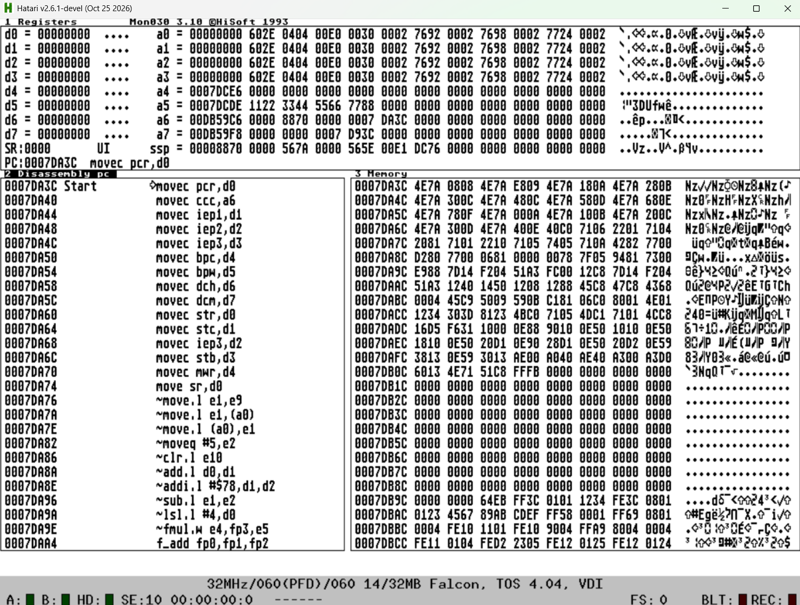
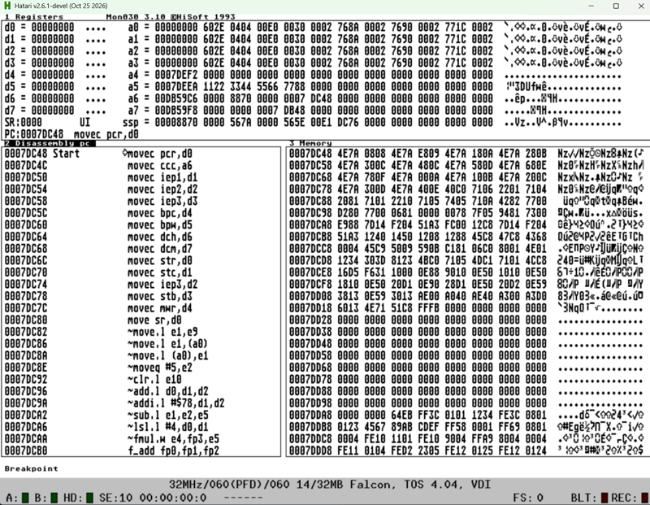
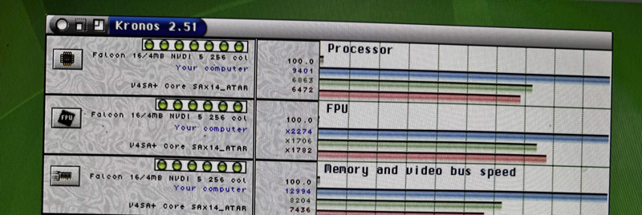

# #atari — Week 45, 2026 (Nov 02 – Nov 08, 2026)

> **TL;DR** — tjomp released a Mon debugger with 68080 support and put DevpacNG on bedroomcoders.com. Atari core performance shots from biggun68080 looked promising (cores are alpha), and a 3-operand bank bug in Mon/Monam was fixed.

## Top topics

### 📦 Mon debugger with 68080 support released; DevpacNG downloadable from bedroomcoders.com
tjomp released Mon with 68080 disassembly and later published the DevpacNG assembler and debugger on bedroomcoders.com, after lonnypursell asked for a central site for the tools.

- Mon disassembles 68080 code correctly, but stepping needs a real 68080 core; Mon does not emulate.
- Screenshots come from Hatari, so 128-bit extended registers cannot be shown yet.
- blast666 suggested pinning the tools; tjomp said documentation would come when time allows.

❓ **Open:** Extended register view and live debugging wait for a mature 68080 Atari core.

📎 [`mon.prg` (57 KB)](https://discord.com/channels/726870908568076380/858224790808821760/1566736428556353596) · 🔗 [Bedroom Coders](https://bedroomcoders.com/)

_tjomp, blast666, lonnypursell, kamelito · [jump →](https://discord.com/channels/726870908568076380/858224790808821760/1566736428556353596)_

### Mon bank-encoding bug for 3-operand integer instructions reported and fixed
tommo8871 found Mon's bank display for 3-operand integer instructions like add.l d0,d1,d2 didn't match the bank definition, and tjomp posted a corrected screenshot.

- Integer 3-operand is not supported, so the extra work was skipped in Monam; float handles it correctly.
- tjomp aimed to fix both Mon and Monam.

_tommo8871, tjomp · [jump →](https://discord.com/channels/726870908568076380/858224790808821760/1566808904866734131)_

### Atari core performance screenshot shared; cores remain alpha
biggun68080 shared a screenshot of the current Atari core running, said it looks a bit faster than a Falcon, and noted Atari cores are alpha; a user flashed SATARI_12856.jic.

- blast666 asked if the alpha was SATARI_12847.jic from apollo-core.com/ALPHA.
- ld2302_98848 flashed SATARI_12856.jic; no microSD, CF works.

🔗 [Apollo core ALPHA downloads](http://apollo-core.com/ALPHA/)

_biggun68080, tjomp, blast666 · [jump →](https://discord.com/channels/726870908568076380/858224790808821760/1567549593393041431)_

## Also this week

- Emulation versus real hardware debate · [jump →](https://discord.com/channels/726870908568076380/858224790808821760/1566765005007880314)
- SD card driver blame debate: coding bug versus hardware · [jump →](https://discord.com/channels/726870908568076380/858224790808821760/1568267901058809936)
- Rajah updates LDG library ports built with libcmini for HighWire · 🔗 [Rajah's library ports updates](https://m.g3l.org/@Rajah/117560944722744636) · [jump →](https://discord.com/channels/726870908568076380/858224790808821760/1567695292747227186)

---
_Generated 2026-11-09 from 92 messages._
