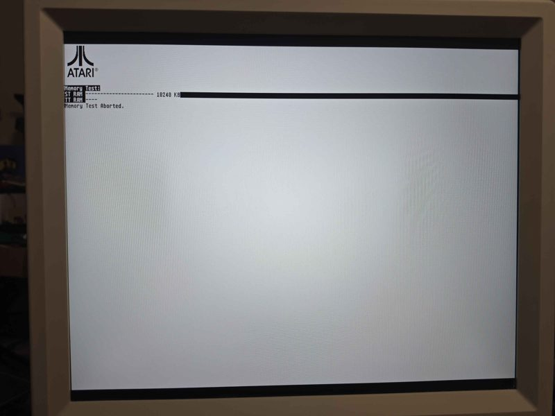

# #atari — Week 47, 2026 (Nov 16 – Nov 22, 2026)

> **TL;DR** — Atari core for V4SA progressed: SATARI_COW alpha fixed the SD controller bug, tjomp released a native ApolloFlash and ApolloTOS ROM, ol4865 showed TOS 5 running on V4SA, and biggun68080 queried MiNT's MMU use ahead of the next release.

## Top topics

### 📦 ApolloFlash and ApolloTOS ROM released for Atari core, testers report issues
tjomp released native ApolloFlash and an ApolloTOS ROM that boots from SD and adds screen modes and languages; testers flashed it and found several bugs.

- Reported: network lost in FreeMiNT after flashing, RTC unsupported, Info/Rename broken on the normal desktop but working with CTRL held at boot.
- 256-color modes and ST-High are broken due to the core; tjomp reported this to biggun68080. Language dialog stays English and will be fixed.
- ld2302_98848 had to shorten the ROM filename to fit 8.3 when flashing from EmuCON.

❓ **Open:** Network loss and slow MiNT boot after flashing remain for tjomp to investigate.

📎 [`AplFlash.ttp` (14 KB)](https://discord.com/channels/726870908568076380/858224790808821760/1572942571993567282) · 📎 [`apollotos.img` (512 KB)](https://discord.com/channels/726870908568076380/858224790808821760/1572942571993567282)

_tjomp, ld2302_98848, blast666, lonnypursell · [jump →](https://discord.com/channels/726870908568076380/858224790808821760/1572942571993567282)_

### SATARI_COW alpha core fixes SD controller, but SD not visible for many testers
biggun68080 released SATARI_COW after tjomp found a register controller bug; several testers still saw no SD card until the new ROM with SD boot arrived.

- tjomp said EmuTOS lacks SD support and sent biggun68080 a new ROM; speed reached 880KB/sec from assembler, about 266KB/sec via EmuTOS.

📎 [`spi_vamp_asm.S` (1 KB)](https://discord.com/channels/726870908568076380/858224790808821760/1572136196614656101) · 🔗 [SATARI_COW.jic](http://apollo-core.com/ALPHA/SATARI_COW.jic) · 🔗 [Apollo ALPHA cores directory](http://apollo-core.com/ALPHA/)

_biggun68080, blast666, tjomp, ol4865 · [jump →](https://discord.com/channels/726870908568076380/858224790808821760/1571917747972083955)_

### TOS 5 from leaked sources ported to V4SA and explored with Claude
slaapliedje used Claude to patch TOS 5, and ol4865 showed it running on V4SA using Mikro's source code with AI help.

🔗 [TOS 5 on V4SA video](http://ol.lutece.net/tos.mp4) · 🔗 [Calamus on V4SA with MyAES](http://v4sa-atari.lutece.net/video/Calamus_V4SA_MyAES.mp4)

_slaapliedje, ol4865, shoggoth_pep, kimchipenguin. · [jump →](https://discord.com/channels/726870908568076380/858224790808821760/1574145718732722297)_

## Also this week

- biggun68080 asks how MiNT uses the MMU for next core release · [jump →](https://discord.com/channels/726870908568076380/858224790808821760/1573642510796849215)
- 📦 HighWire fork gets SVG decoder and 0.4.10 release · 📎 [`20261117_181508.mp4` (5.1 MB)](https://discord.com/channels/726870908568076380/858224790808821760/1572299320072478812) · 🔗 [HighWire 0.4.10 announcement](https://m.g3l.org/@Rajah/117660841042828798) · 🔗 [Feng Shui distribution for GEM use](https://ptonthat.fr/feng-shui-distribution-for-gem-use/#comments) · [jump →](https://discord.com/channels/726870908568076380/858224790808821760/1572154749921529966)
- slaapliedje's manx browser for 68030 System V Unix shared · 🔗 [slaapliedje/manx](https://github.com/slaapliedje/manx) · [jump →](https://discord.com/channels/726870908568076380/858224790808821760/1572456280939831407)

## Links

**Code & tools**
- [Uwe Seimet's Atari page (STFLAGS)](https://www.seimet.de/atari/en/) — Tool to set LDG libraries' flags to global for memory protection. _(rajah_19927)_
- [Atari-ST-Simple-Clock-Accessory](https://github.com/tobrew/Atari-ST-Simple-Clock-Accessory) — Clock accessory found for MyAES top-right corner. _(blast666)_

**Projects & releases**
- [SATARI_128.jic](http://apollo-core.com/ALPHA/SATARI_128.jic) — New alpha Atari core tested by blast666. _(biggun68080)_

**Articles & videos**
- [I'm Rebuilding the 6502 from Scratch, One Gate at a Time | Episode 1](https://www.youtube.com/watch?v=czPMjs0Y0zc) — Video series on 6502 in an FPGA, shared in reply to 6502 talk. _(tjomp)_

**Other**
- [atarionline.pl](http://atarionline.pl) — Site that crashes HighWire in testing. _(rajah_19927)_

---
_Generated 2026-11-23 from 345 messages._
