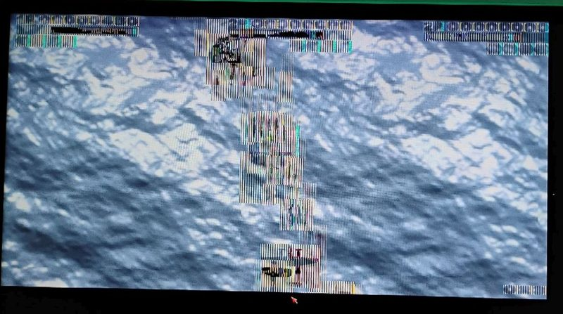

# #compatibility-campaign — Week 41, 2026 (Oct 05 – Oct 11, 2026)

> **TL;DR** — danyppc reported corrupted graphics in the game 194x on the latest 12256D core; biggun68080 said the game has looked like this for a couple of years and has not had time to update it.

## Top topics

### 194x graphics corrupted on 12256D core; biggun68080 says game has looked like this for years
danyppc reported corrupted graphics in 194x on the latest 12256D core and asked whether SAGA sprites changed; biggun68080, who made the game, said it has looked this way for years and is not yet updated.

- danyppc found the game in a Coffin distribution and is unsure whether the problem exists on earlier cores.
- biggun68080 has been too busy to update the game.
- tjomp asked whether it was made in the Arcade Game Construction Kit; no answer in the thread.

❓ **Open:** Whether 194x will be fixed or stay out of the Apollo games remains unanswered.

_danyppc, biggun68080, arcam10, tjomp · [jump →](https://discord.com/channels/726870908568076380/1383027223128444928/1556652518040145940)_

---
_Generated 2026-10-12 from 7 messages._
