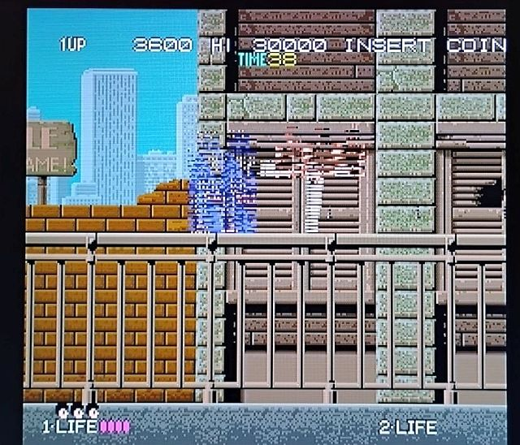

# #compatibility-campaign — Week 46, 2026 (Nov 09 – Nov 15, 2026)

> **TL;DR** — Two Vampire/Apollo compatibility reports: Captured Dreams music timing broke on a Vampire V2 until NoCache was applied, and Bad Dudes showed doubled sprites on Apollo V4. Suggestions were `apollocontrol tu=3` and the SA_MOVEH core.

## Top topics

### Captured Dreams music timing broken on Vampire V2; NoCache fixes but is too slow
mvk1993 reported broken music timing in Black Lotus's Captured Dreams on a Vampire V2 (A1200, CoffinOS R65); NoCache fixed it but slowed things, and kamelito suggested `apollocontrol tu=3`.

- Problem occurred with both WHDLoad and the standalone EXE.
- Latest core was in use on CoffinOS R65.

❓ **Open:** Whether `apollocontrol tu=3` resolves the slowdown was not reported.

_mvk1993, biggun68080, kamelito · [jump →](https://discord.com/channels/726870908568076380/1383027223128444928/1570480980740014161)_

### Bad Dudes AGA sprites doubled with interlines on Apollo V4
danyppc reported doubled, interlined sprites in Jotd's Bad Dudes on Apollo V4 (correct on real Amiga and Minimig); biggun68080 suspects an Fmode setting problem.

- michael_1260 says core SA_MOVEH.jic has some graphical glitches but sprites are OK.
- danyppc is on stable 12205 on an A6000.
- michael_1260 says Apidya no longer locks the screen with SA_MOVEH.

_danyppc, biggun68080, michael_1260 · [jump →](https://discord.com/channels/726870908568076380/1383027223128444928/1571103886557577266)_

---
_Generated 2026-11-16 from 15 messages._
