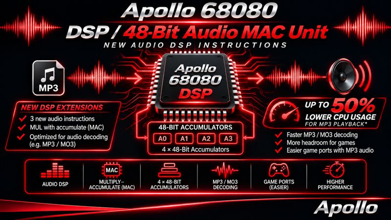
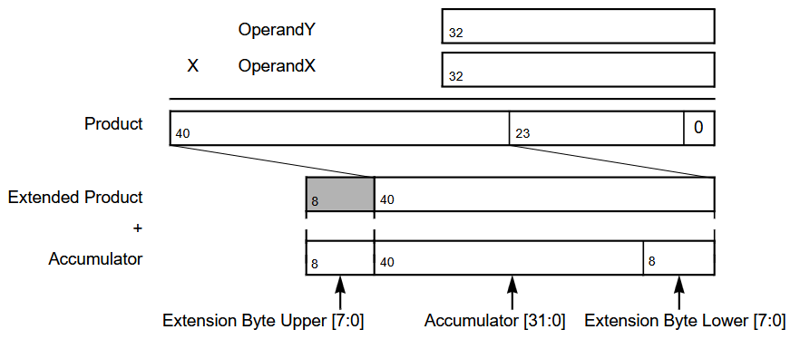

# #cpu-design-talk — Week 46, 2026 (Nov 09 – Nov 15, 2026)

> **TL;DR** — angelofspectral announced new 68080 MAC/MSAC instructions for faster MP3 decoding, later adding MAAAC and MASAC. The channel debated 16-bit input handling, encoding space, and 16x16 vs 32x32 MAC; MSSAC is being built into the core.

## Top topics

### 68080 gets MAC/MSAC DSP instructions for faster MP3 decoding
angelofspectral announced MAC.L and MSAC with four accumulators and MOVECLR, claiming around 200% faster MP3 decoding; tjomp plans Genam and VaMP3 support and r3dbug suggested mpega080 library support.

- Accumulator SPRs are 81C-81F (ACC0-ACC3); MOVECLR reads an accumulator into a D register and clears it.
- Useful also for FFT, FIR and IIR filters.
- tommo8871 advised keeping movec clean and tested core builds: MAC was not yet executed and ACC stayed zero.

❓ **Open:** When MAC will reach the Atari core (asked by blast666) was not answered.

🔗 [APOLLO 68080 - High Performance Processor](http://apollo-core.com/index.htm?page=coding&tl=1) · 🔗 [APOLLO CPU Knowledge Forum](http://apollo-core.com/knowledge.php?b=4&note=36336)

_angelofspectral, tommo8871, rudi09421, r3dbug · [jump →](https://discord.com/channels/726870908568076380/1530182174949642240/1569732786779070687)_

### MAAAC and MASAC added; MSSAC being built; PACKACC proposed
angelofspectral added dual-accumulator instructions MAAAC and MASAC, and after rudi09421's request confirmed MSSAC is building in the core; rudi09421 also proposed a PACKACC saturating pack instruction.

- biggun68080 confirmed any of the four ACCUs can be chosen freely, so MASAC covers MSAAC.
- Saturating currently costs about 6 cycles in software, per biggun68080.
- rudi09421 also asked for ADD/SUB between accumulators; biggun68080 found this useful given the pipeline read-out delay of 4 cycles.

_angelofspectral, rudi09421, biggun68080 · [jump →](https://discord.com/channels/726870908568076380/1530182174949642240/1570179378015641633)_

### Design debate: 16-bit sample input, MAC.W modes, encoding space and 16x16 vs 32x32
The group discussed how to feed 16-bit samples into the 32-bit MAC, proposing MOVEH.W/MOVS.W and word-sized MAC with high/low selection; opinions split on 16x16 versus future-proof 32x32.

- Encoding sits in the MUL opcode space for Atari/Mac OS compatibility, with 3 free bits; MAC can be MAAAC with identical ACCs.
- ACCU is 8.32.8 bits (guard, value, fraction), per biggun68080.
- rudi09421 says 16x16 suffices for MP3 but prefers 32-bit for future-proofing.

❓ **Open:** Whether to add a 16-bit mode via a mode bit or stolen DIV encoding bits is undecided.

_biggun68080, rudi09421, tommo8871, blast666 · [jump →](https://discord.com/channels/726870908568076380/1530182174949642240/1570685628017021021)_

## Also this week

- Should 68080 copy the 56000 DO hardware loop and circular buffers? · 🔗 [Circular buffer - Wikipedia](https://en.wikipedia.org/wiki/Circular_buffer) · [jump →](https://discord.com/channels/726870908568076380/1530182174949642240/1571165594068189264)

---
_Generated 2026-11-16 from 308 messages._
