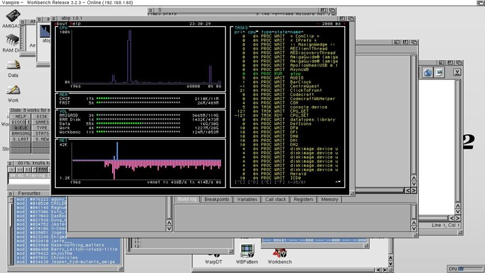
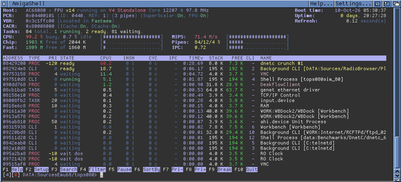

# #developers — Week 41, 2026 (Oct 05 – Oct 11, 2026)

> **TL;DR** — _.cygnus._ released atop 1.0 and a 1.0.1-68k fix for a 100% CPU bug found by michael_1260; .flype shared the TOPS beta with Vampire performance counters. AI-versus-human creativity debate continued, plus a Sinclair QL chat and a cross-compiler question.

## Top topics

### 📦 atop 1.0 released; 1.0.1-68k fixes 100% CPU bug reported by michael_1260
_.cygnus._ uploaded atop 1.0 to Aminet, and after michael_1260 reported a CPU_SET task using nearly 100% CPU on V4 standalone, a fixed 1.0.1-68k build brought it to 0%.

- atop 1.0 focuses on aesthetics and cross-platform support: AmigaOS 3.x, ApolloOS, AROS, AmigaOS 4.x and MorphOS from one code base.
- Bug seen on core 12200, AmigaOS 3.2.3, Kickstart A1200 47.4; _.cygnus._ could not reproduce it in their test fleet.
- michael_1260 asked for longer volume names, since 'Workbench' shows as 'Workbenc'.

🔗 [atop-1.0.1-68k.lha](https://ftp.amigascne.org/pub/atop/atop-1.0.1-68k.lha)

__.cygnus._, michael_1260 · [jump →](https://discord.com/channels/726870908568076380/730698753513750539/1558158413463298081)_

### 📦 .flype releases TOPS beta with per-task Vampire performance counters
.flype shared TOPS 0.45 beta, an htop-like ViNCEd tool showing per-task Exec load and AC68080 counters, with a Dracula theme, for testing on real Vampires.

- Shows Vampire model, core version and frequency, cacr, vbr, pcr, and Clock/Mips1/Mips2/Mips3 counters; sortable, filterable.
- Exec task load analysis only works on AmigaOS, not Aros68k; not yet on Aminet.
- kamelito asked whether more Apollo settings could be shown; .flype said it can be discussed.

📎 [`tops080beta045.zip` (83 KB)](https://discord.com/channels/726870908568076380/730698753513750539/1558636244039368814) · 🔗 [Dracula Theme for 400+ apps](https://draculatheme.com/)

_.flype, _.cygnus._, other_pisklak, kamelito · [jump →](https://discord.com/channels/726870908568076380/730698753513750539/1558636244039368814)_

### AI versus human creativity debate, using filmmaking and fast-food analogies
Following up on last week's AI-for-non-programmers thread, members debated whether AI use undermines craft and quality, with analogies to cooking, fast food and mass production.

- asktodd compared prompting to ordering from a menu rather than cooking.
- niding saw AI as a useful preview tool that still needs a human to verify output.
- olafsch. argued AI-produced software is not lower quality than handmade.

🔗 [Stanisław Lem opisał pułapkę, do której weszliśmy dobrowolnie...](https://www.youtube.com/watch?v=zpATB0Mitbc)

_asktodd, kamelito, niding, olafsch. · [jump →](https://discord.com/channels/726870908568076380/730698753513750539/1557660410579128352)_

## Also this week

- Sinclair QL chat and question on new Vampire core release date · 🔗 [Sinclair QL TV advertisement 1985](https://www.youtube.com/watch?v=AO5BUIKykMM) · [jump →](https://discord.com/channels/726870908568076380/730698753513750539/1557993570349359115)
- Which cross-compiler to use for Vampire: amiga-gcc vs ApolloCrossDev · 🔗 [amiga-gcc](https://codeberg.org/bebbo/amiga-gcc) · 🔗 [ApolloGenie](https://www.purelab-tefc.ch/vampire/ApolloGenie.php) · [jump →](https://discord.com/channels/726870908568076380/730698753513750539/1558907636294877405)

---
_Generated 2026-10-12 from 96 messages._
