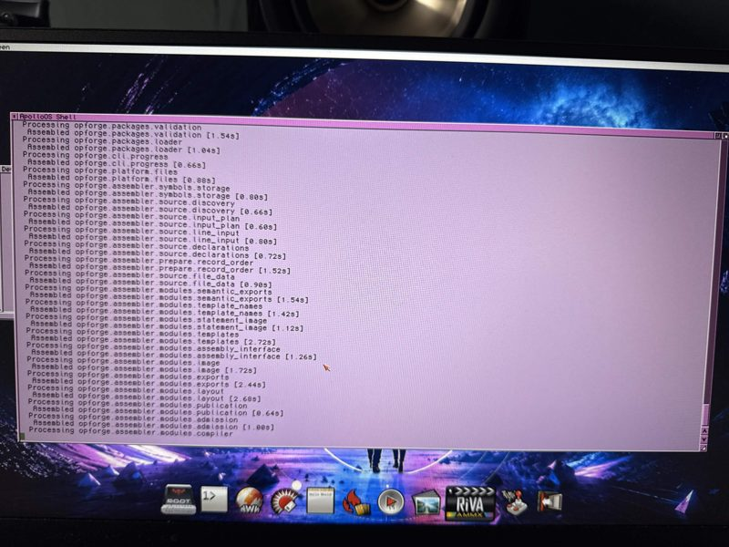

# #developers — Week 43, 2026 (Oct 19 – Oct 25, 2026)

> **TL;DR** — Rebound Retro Studio got a Windows version and beta.3 after positive V4 feedback, eriktier got incremental builds working in opForge, and tommo8871 published a corrected 68080 Programmer's Reference Manual.

## Top topics

### 📦 Rebound Retro Studio beta.3 adds Windows version and fixes
dukuu5752 released beta.3 of Rebound Retro Studio with a Windows build and fixes; paul_doughty confirmed it works with a V4 Standalone.

- paul_doughty saw no response from the V4 during link setup, but it works; not yet tried on an A6000.
- dukuu5752 suggests clicking test connection a few times and will look into the glitch; has no V4 Standalone to test.

🔗 [Rebound Retro Studio — Rebound Retro Lab](https://rebound-retro-lab.com/tools/rebound-retro-studio)

_dukuu5752, paul_doughty · [jump →](https://discord.com/channels/726870908568076380/730698753513750539/1563255324524281876)_

### opForge incremental builds work; assembler speed and compatibility discussed
eriktier got incremental builds working in opForge, reassembling only changed files and dependants; kamelito and tommo8871 compared assembly speed with other assemblers.

- Full build of 188 modules takes about 4 minutes in FS-UAE within 8MB; a second build takes 25% of that.
- A build resumes after an Amiga hang, reusing already assembled modules.
- eriktier won't add Devpac/Vasm compatibility mode, likely a converter instead.

❓ **Open:** eriktier plans a clean-up pass and moving the new opForge generation to a release candidate, then V4 optimization.

_eriktier, kamelito, tommo8871 · [jump →](https://discord.com/channels/726870908568076380/730698753513750539/1563099491635306548)_

### 📦 68080 Programmer's Reference Manual updated with opcode fix
tommo8871 posted an updated 68080PRM correcting an opcode error on page 74.

- Opcode $2F on page 74 corrected to $2E.
- Vector table on page 9 no longer contains tex; added as a note.

📎 [`AC68080PRM.pdf` (420 KB)](https://discord.com/channels/726870908568076380/730698753513750539/1563924972471193690)

_tommo8871 · [jump →](https://discord.com/channels/726870908568076380/730698753513750539/1563924972471193690)_

---
_Generated 2026-10-26 from 32 messages._
