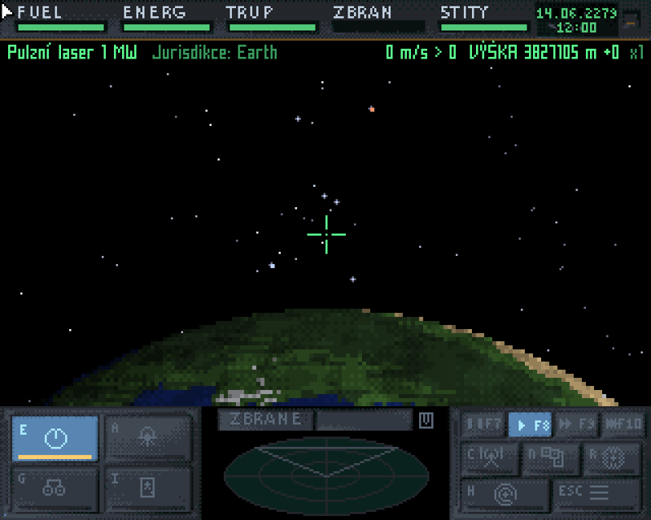

# #developers — Week 44, 2026 (Oct 26 – Nov 01, 2026)

> **TL;DR** — Week featured a long debate on gratitude and AI-assisted Amiga coding, tommo8871's 68080 PRM fixes, new mpega080/flacdec and ffplay releases, Noro's Without Frontier space sim, an ApolloExplorer NOICON bug, and a Milkytracker port.

## Top topics

### 📦 Developers' gratitude and AI-assisted coding debated after mpega080 and flacdec release
After tuko1548 posted updated mpega080 and flacdec, requests for more codecs sparked a debate on thanking developers, which turned into a wider discussion of AI's role in Amiga development.

- biggun68080 and r3dbug argued that free tools get requests instead of thanks; tjomp said asking is human association, not stupidity.
- olafsch.and biggun68080 said AI accelerates Amiga development; r3dbug fears a flood of mediocre programs.
- biggun68080 said new cores add improved FPU encoding, already in tommo8871's disassembler/debugger, with compiler support planned.

📎 [`mpega080.lha` (89 KB)](https://discord.com/channels/726870908568076380/730698753513750539/1564700859323908280) · 📎 [`flacdec.lha` (34 KB)](https://discord.com/channels/726870908568076380/730698753513750539/1564700859323908280)

_biggun68080, r3dbug, tuko1548, olafsch. · [jump →](https://discord.com/channels/726870908568076380/730698753513750539/1564713205350015167)_

### Noro presents Without Frontier, a Frontier-like space sim for Amiga and PC
noro2328 described Without Frontier, a 3D space sim with assembly AGA/68K renderer; biggun68080 questioned them on 030/FPU use, Z-buffering, SDL and Maggie 3D.

- Minimum: AGA, 68030, 8 MB Fast RAM; 320×256; 15-30 FPS on 030/040; no multiplayer.
- Uses FPU when present (not on 030), Z-buffer, and C2P with delta compression.
- noro2328 will test extreme configs at Prase Party in late November and wants a MiniGL for Vampire.

🔗 [Without Frontier – A Space sim for the Amiga and PC](https://josefnemec.cz/wf/?lang=en) · 🔗 [Galerie · Without Frontier](https://josefnemec.cz/wf/?p=media) · 🔗 [Amiga Portal forum thread on Without Frontier](https://www.amigaportal.cz/node/180554)

_noro2328, biggun68080, olafsch. · [jump →](https://discord.com/channels/726870908568076380/730698753513750539/1564754935508111462)_

### 📦 tommo8871 updates 68080 PRM with many fixes
tommo8871 released a new AC68080PRM.pdf fixing wrong opcodes, examples and notes; nihirash asked for a printed edition.

- Fixes include padd opcode bit, psub example and dbcc notes; added superscalar pairing section.
- tommo8871 has no print solution yet, and the PRM will keep changing until the 68080 is final.

📎 [`AC68080PRM.pdf` (420 KB)](https://discord.com/channels/726870908568076380/730698753513750539/1564629265981640754)

_tommo8871, nihirash, biggun68080 · [jump →](https://discord.com/channels/726870908568076380/730698753513750539/1564629265981640754)_

## Also this week

- ApolloExplorer NOICON tooltype doesn't work; ronybeck accepts it as a bug · 🔗 [GitHub - ronybeck/ApolloExplorer](https://github.com/ronybeck/ApolloExplorer) · [jump →](https://discord.com/channels/726870908568076380/730698753513750539/1564222444128968726)
- 📦 olafsch. shares ffplay multimedia player for Amiga · 📎 [`ffplay` (1.8 MB)](https://discord.com/channels/726870908568076380/730698753513750539/1565514317514932254) · [jump →](https://discord.com/channels/726870908568076380/730698753513750539/1565514317514932254)
- Members share AI coding workflows; zyber.se proposes a group chat · 📎 [`scrap_city.mov` (6.5 MB)](https://discord.com/channels/726870908568076380/730698753513750539/1565545243850448957) · [jump →](https://discord.com/channels/726870908568076380/730698753513750539/1565481871901462580)
- axlv500 ports Milkytracker, seeks Vampire testers · 📎 [`VID_20261031_213632.mp4` (3.5 MB)](https://discord.com/channels/726870908568076380/730698753513750539/1566189727097298977) · [jump →](https://discord.com/channels/726870908568076380/730698753513750539/1566185000183926915)
- biggun68080 recommends TEX instruction for faster 3D texturing · [jump →](https://discord.com/channels/726870908568076380/730698753513750539/1564924109132136459)
- vasm 68k website is down · [jump →](https://discord.com/channels/726870908568076380/730698753513750539/1564176374225305651)

## Links

**Articles & videos**
- [Amiga 3D Star Wars Demo – Real-Time Raytracing with Maggie 3D Lib](https://www.youtube.com/watch?v=M_WoLPbCbR8) — Maggie3D example demo shown to noro2328. _(biggun68080)_

---
_Generated 2026-11-02 from 308 messages._
