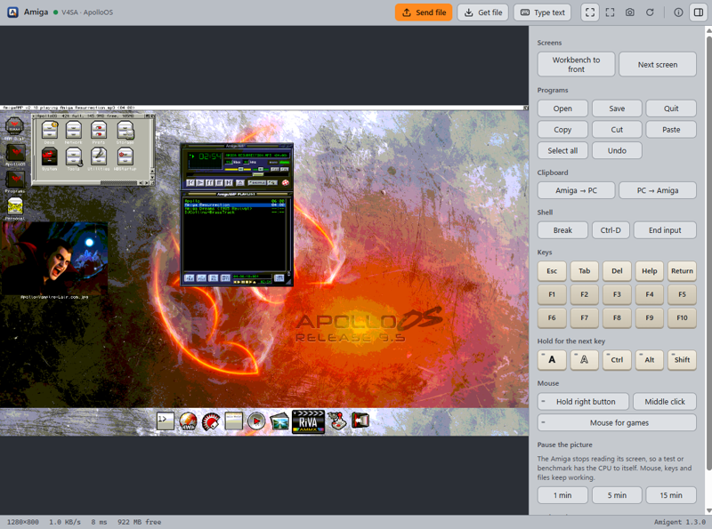

# #developers — Week 46, 2026 (Nov 09 – Nov 15, 2026)

> **TL;DR** — Heavy AI-on-Amiga week: cygnus built a clean-room AIBB and debated AI/copyright; newl_48053 got a forked amigent running on V4 under ApolloOS; olafsch. shared an AMMX ffplay; official ApolloKnowledgeBase repo announced for AI coding.

## Top topics

### 📦 Official ApolloKnowledgeBase repo announced as reference for AI-assisted Apollo V4 coding
r3dbug named ApolloTeam-dev/ApolloKnowledgeBase the official reference for AI coding, after a discussion on whether AI needs 68080-specific training or just an up-to-date manual.

- blast666 said only the 080 programming manual and 'skills' are needed, not dedicated training
- tommo8871 said the 080 is changing quickly; validated new features go into the 68080PRM

🔗 [ApolloKnowledgeBase](https://github.com/ApolloTeam-dev/ApolloKnowledgeBase)

_r3dbug, blast666, tommo8871, sheepsofrage · [jump →](https://discord.com/channels/726870908568076380/730698753513750539/1571224269386424420)_

### newl_48053 gets forked amigent working on V4 under ApolloOS; audio capture hits limits
newl_48053 built a forked amigent with ApolloCrossDev that visually works on V4; PiP and AHI capture work, but audio passthrough looks unworkable due to network limits.

- The root amigent repository version does not work on V4
- nenarek saw frame-time spikes from amigent and prefers amimcp and ApolloExplorer, or HDMI capture
- Limits: polling latency up to 250ms, 300KB/s ceiling, MTU 9k setting doesn't stick

🔗 [amigent](https://github.com/akustikrausch/amigent) · 🔗 [amimcp](https://github.com/thomas-luebker/amimcp)

_newl_48053, nenarek, zyber.se, vgn4899 · [jump →](https://discord.com/channels/726870908568076380/730698753513750539/1570693628043730944)_

### cygnus releases clean-room AIBB rewrite, sparking AI copyright and creativity debate
_.cygnus._ built a clean-room AIBB implementation after failing to reach the original author, then debated legality, AI creativity and model collapse with biggun68080, kamelito and olafsch.

- Process used separate phases: one analyzing disassembly without writing code, one writing code with only algorithm descriptions
- biggun68080 recalled AIBB source on a Fred Fish disk; _.cygnus._ found only binary disk 439 (v2.0)
- _.cygnus._ suggested a dedicated AI development channel

__.cygnus._, biggun68080, olafsch., kamelito · [jump →](https://discord.com/channels/726870908568076380/730698753513750539/1569834751232319561)_

## Also this week

- olafsch. shares AMMX-optimized ffplay; morten.dynamite benchmarks on MantiCore · 📎 [`ffplay` (2.5 MB)](https://discord.com/channels/726870908568076380/730698753513750539/1570481797534322768) · 📎 [`ffplay` (2.5 MB)](https://discord.com/channels/726870908568076380/730698753513750539/1570466172556542052) · 📎 [`CLIP0174.mpg` (23.2 MB)](https://discord.com/channels/726870908568076380/730698753513750539/1570466172556542052) · 📎 [`CLIP0174.AVI` (22.7 MB)](https://discord.com/channels/726870908568076380/730698753513750539/1570469523423764575) · 📎 [`Wizball.sid` (8 KB)](https://discord.com/channels/726870908568076380/730698753513750539/1570487516472156200) · 🔗 [AC68080 PRM](http://www.apollo-core.com/documentation/AC68080PRM.pdf) · [jump →](https://discord.com/channels/726870908568076380/730698753513750539/1570466172556542052)
- newl_48053 and biggun68080 clash over HRTmon debugger on V4/A6000 · [jump →](https://discord.com/channels/726870908568076380/730698753513750539/1570382129802514566)
- biggun68080: AI could give 100% speedup on 68080; 32 data registers in alpha Amiga core · [jump →](https://discord.com/channels/726870908568076380/730698753513750539/1570421874129641523)
- .hitchhikr reports blitter implementation differs from original Amiga blitter · [jump →](https://discord.com/channels/726870908568076380/730698753513750539/1569329739984932975)
- .everstar proposes AI-generated fixes for ApolloOS issues · 📎 [`MultiView_114.txt` (5 KB)](https://discord.com/channels/726870908568076380/730698753513750539/1570472962245660854) · 📎 [`message.txt` (5 KB)](https://discord.com/channels/726870908568076380/730698753513750539/1570512229525098597) · 📎 [`message.txt` (6 KB)](https://discord.com/channels/726870908568076380/730698753513750539/1570519872562012181) · [jump →](https://discord.com/channels/726870908568076380/730698753513750539/1570446177500004414)
- VaMP3 conflicts with AHI because it writes Arne audio directly · 🔗 [VaMP3](https://github.com/Bedroomcoders/VaMP3) · 🔗 [ApolloAMP](https://www.purelab-tefc.ch/vampire/ApolloAMP.php) · [jump →](https://discord.com/channels/726870908568076380/730698753513750539/1570738138626662514)

## Links

**Articles & videos**
- [Discord message on Amiscord client](https://discord.com/channels/726870908568076380/730698753513750539/1565452169040240831) — Pointer for using Discord on Amiga. _(r3dbug)_
- [Discord message on ApolloVNC](https://discord.com/channels/726870908568076380/815881200782147624/1570455212055855256) — How to use Firefox and Discord via ApolloVNC. _(r3dbug)_

**Other**
- [Apollo Vampire Lair's Shop](https://ko-fi.com/apollovampirelair/shop) — Shop shared where VaMP3 binary is available. _(tjomp)_

---
_Generated 2026-11-16 from 347 messages._
