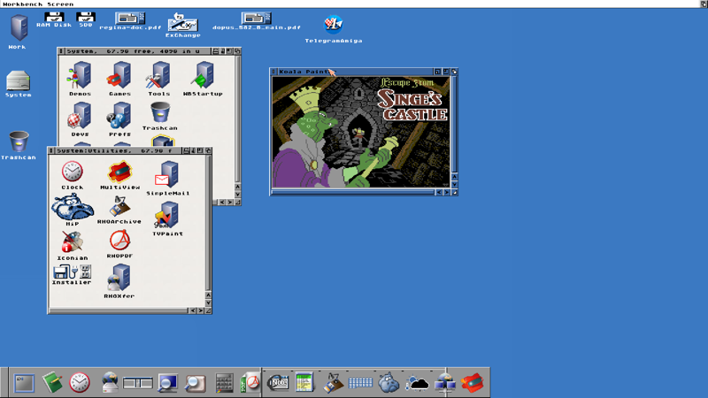

# #english — Week 44, 2026 (Oct 26 – Nov 01, 2026)

> **TL;DR** — ApolloAMP 26.9 R1 shipped with a license-check bug that r3dbug fixed with ApolloAMP_FIX. olafsch. showed a multimedia player and AI-built datatypes. NFS client options for AmigaOS 3.9 were compared, and newcomers discussed whether to buy an Apollo A6000.

## Top topics

### 📦 ApolloAMP 26.9 R1 'License Expired' bug fixed with ApolloAMP_FIX
skizzolfscrew reported ApolloAMP_FE_26_9_R1 showing 'License Expired'; r3dbug admitted a license-check mistake and posted ApolloAMP_FIX as a workaround.

- Fix: run ApolloAMP_FIX once and close it, then run ApolloAMP 26.9 R1 as before.

📎 [`ApolloAMP_FIX` (146 KB)](https://discord.com/channels/726870908568076380/827071192195268608/1565458726960238632)

_skizzolfscrew, r3dbug · [jump →](https://discord.com/channels/726870908568076380/827071192195268608/1565418085949771949)_

### 📦 olafsch. shows ffplayenv multimedia player for AmigaOS 3.x and AROS m68k
olafsch. shared a work-in-progress player playing many video, tracker and chip-music formats, with AHI or Paula output, tested on AmigaOS 3.x and AROS m68k.

- Options include `paula` (14bit), `paula8`, `window` and `rtg`; olafsch. says `paula` gives the best sound.
- Plays mp1/2/3/4, AVI, and C64 SID and Atari SNDH formats.

📎 [`ffplayenh` (1.8 MB)](https://discord.com/channels/726870908568076380/827071192195268608/1565672118748979271)

_olafsch., biggun68080 · [jump →](https://discord.com/channels/726870908568076380/827071192195268608/1565672118748979271)_

### AI-generated datatypes: olafsch. builds Koala datatype with Claude; eric_gustafson shares free-model tips
olafsch. created a Koala painter datatype in about five minutes with Claude, writing E-VO code, and plans more C64 and retro formats; eric_gustafson suggested OpenCode and OpenRouter free models.

- olafsch. compiles the generated code, copies it to `classes/datatypes` and the descriptor to `devs`.
- eric_gustafson says OpenRouter accounts with at least $10 in credits get up to 1,000 free-model requests per day.

🔗 [E-VO Amiga E Compiler](https://github.com/dmcoles/EVO) · 🔗 [Free AI Models on OpenRouter](https://openrouter.ai/collections/free-models)

_olafsch., eric_gustafson, nihirash, kamelito · [jump →](https://discord.com/channels/726870908568076380/827071192195268608/1566053420673011862)_

## Also this week

- NFS client for AmigaOS 3.9: AmiNFSv3 works, server choice mattered · 🔗 [nfs-handler_rs](https://aminet.net/package/comm/net/nfs-handler_rs) · 🔗 [AmiNFSv3](https://aminet.net/comm/net/AmiNFSv3.lha) · 🔗 [How to set up NFS and mount on Amiga](https://amihelper.blogspot.com/2018/12/how-to-set-up-nfs-and-mount-on-amiga.html) · [jump →](https://discord.com/channels/726870908568076380/827071192195268608/1564650873404264560)
- Newcomer weighs buying Apollo A6000 and asks for learning resources · 🔗 [AmigaOS Documentation Wiki](https://wiki.amigaos.net/wiki/Main_Page) · [jump →](https://discord.com/channels/726870908568076380/827071192195268608/1565773776669384725)

## Links

**Articles & videos**
- [Making Content from Discoverable Servers Easier to Discover](https://discord.com/blog/making-content-from-discoverable-servers-easier-to-discover) — Asked whether Discord's discoverability change affects the Apollo server. _(mr.shell)_
- [Software Engineers in 2028](https://www.youtube.com/watch?v=uYG1TAzexdo) — Satirical video about AI-era software engineers, shared without comment. _(kamelito)_

---
_Generated 2026-11-02 from 133 messages._
