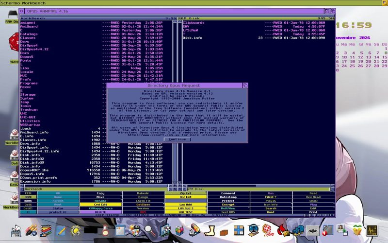

# #english — Week 45, 2026 (Nov 02 – Nov 08, 2026)

> **TL;DR** — Apollo team clarified SD vs CF speeds (about 2MB/s vs 12MB/s) and said ApolloBoot R93 will default to AmiTCP-NG. Dopus4 is being optimized for the 68080, olafsch.'s Amiga course went online, and biggun68080 teased a Linux/uClinux clue.

## Top topics

### CF (IDE) beats SD (SPI) on A6000; faster SD planned in a future core
willemdrijver explained that CF over IDE is currently the preferred storage on Apollo hardware because SD runs over the slower SPI bus, with SD speed improvements planned.

- Current speeds: about 2MB/s for SD on SPI versus 12MB/s for CF on IDE.
- Plan is to use more pins and rewrite the SD driver for much higher speeds.
- The IDE driver is part of the ApolloOS ROM (or AmigaOS expansion ROM); the SD driver handles RDB, MBR, GPT and ISO9660.

🔗 [sagasd-device](https://github.com/alynna/sagasd-device/tree/master/sagasd)

_willemdrijver, veneficvs, biggun68080, alynnafoxie · [jump →](https://discord.com/channels/726870908568076380/827071192195268608/1567926855930224751)_

### ApolloBoot R93 to default to AmiTCP-NG; new Amiga TCP/IP stacks discussed
alynnafoxie asked about AmiNetXDuo as a Roadshow replacement; eric_gustafson listed other new stacks, and willemdrijver announced ApolloBoot R93 will use AmiTCP-NG as default for AmigaOS partitions.

- alynnafoxie says Roadshow expires after 30 minutes despite a paid bsdsocket.library.
- eric_gustafson named TheWire13 (works on KS/WB 1.3) and Riptide as other new stacks.
- alynnafoxie later showed an Amiga talking IPv6.

🔗 [AmiNetXDuo](https://github.com/tinic/AmiNetXDuo) · 🔗 [farsonic/Riptide](https://github.com/farsonic/riptide) · 🔗 [TheWire13 on Aminet](https://aminet.net/package/comm/tcp/TheWire13)

_alynnafoxie, eric_gustafson, willemdrijver · [jump →](https://discord.com/channels/726870908568076380/827071192195268608/1567929376429969622)_

### Dopus4 being optimized for 68080 Vampire
skizzolfscrew announced work is underway to optimize Dopus4 for the 68080 processor, with a screenshot; michael_1260 mentioned another project with a new dock in progress.

_skizzolfscrew, michael_1260 · [jump →](https://discord.com/channels/726870908568076380/827071192195268608/1569003622908559572)_

## Also this week

- olafsch.: AI-assisted Amiga and AROS course on aros-vision.de · 📎 [`VID_20261102_183358.mp4` (8.6 MB)](https://discord.com/channels/726870908568076380/827071192195268608/1566868347780595812) · 🔗 [aros-vision.de home](https://aros-vision.de/) · 🔗 [Winuae.uae config](http://www.aros-vision.de/downloads/Winuae.uae) · [jump →](https://discord.com/channels/726870908568076380/827071192195268608/1566759178821967902)
- 📦 olafsch. asks testers for ffplayenh multimedia player · 📎 [`ffplayenh` (2.3 MB)](https://discord.com/channels/726870908568076380/827071192195268608/1568203546455838780) · 📎 [`OpenVideoToasterPromo.mov` (2.8 MB)](https://discord.com/channels/726870908568076380/827071192195268608/1568140138180251748) · [jump →](https://discord.com/channels/726870908568076380/827071192195268608/1568203546455838780)
- Monitor report: IIYAMA G2771HSU-B1 works with all SAGA modes · [jump →](https://discord.com/channels/726870908568076380/827071192195268608/1568606294632304673)
- ApolloUpdate token is for Apollo Vampire Lair software subscriptions · [jump →](https://discord.com/channels/726870908568076380/827071192195268608/1568369813640708208)
- V4 ownership transfer: no registration exists · [jump →](https://discord.com/channels/726870908568076380/827071192195268608/1567060252791152731)
- willemdrijver found and is fixing an SD-card bug · [jump →](https://discord.com/channels/726870908568076380/827071192195268608/1568580332158976082)

## Links

**Articles & videos**
- [Arnes Amiga assembly course: waving flag](https://www.youtube.com/watch?v=E-aQx_7QP6c) — Video of a 14-year-old's waving flag effect. _(biggun68080)_
- [Arnes Amiga assembly course: beautiful math](https://www.youtube.com/watch?v=ZJdU0wEWTLo) — Another of Arne's demo-effect assembly videos. _(biggun68080)_
- [APOLLO CPU Knowledge Forum](http://apollo-core.com/knowledge.php?b=4&note=38608) — Source for debugger joke. _(tommo8871)_

**Other**
- [Apollo Unicorn color schemes](https://apollo-games.de/unicorn.php) — Asked which scheme is graveyard grey. _(veneficvs)_

---
_Generated 2026-11-09 from 359 messages._
