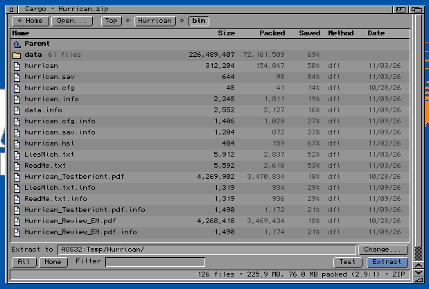

# #english — Week 47, 2026 (Nov 16 – Nov 22, 2026)

> **TL;DR** — thgill developed and released Cargo 0.84, a fast LHA/Zip archiver for Amiga, with community benchmarks on 020/030. nenarek released SDFormat 1.0 for FAT32 SD cards. DockAwesome 1.0 beta3 came out. willemdrijver outlined the AI-assisted ApolloOS R10 rebuild.

## Top topics

### 📦 Cargo 0.84 LHA/Zip archiver released; community benchmarks on 020/030
thgill progressed from teasing Cargo to a video demo and a 0.84 release; amigafan_64348 and skizzolfscrew tested it, with results varying by machine.

- Claimed 2-3x faster LHA/Zip extraction on 68080; single ~160 KB executable choosing CPU-specific inner loops at startup via AttnFlags.
- amigafan_64348 measured 17s vs LHA 40.59 at 38s on a 020 with AmigaOS 2.1, but only parity with LHA on an A1200 030 and with LZX on 030.
- thgill suspects a bug limiting speed on 020/030 systems; LZX support was requested and added to the compression list.

❓ **Open:** thgill suspects a bug slowing 020/030 systems; still to be investigated.

📎 [`Cargo_0.84.lha` (101 KB)](https://discord.com/channels/726870908568076380/827071192195268608/1573049110343454750) · 📎 [`Cargo2.mp4` (8.7 MB)](https://discord.com/channels/726870908568076380/827071192195268608/1572379820422070447) · 🔗 [Lha - New development of the archiver for AmigaOS 2.04+](https://mviess.de/amiga/lha/en/) · 🔗 [MK2_CFG_V11.LHA](https://wiki.icomp.de/w/images/3/3f/MK2_CFG_V11.LHA)

_thgill, amigafan_64348, skizzolfscrew, kamelito · [jump →](https://discord.com/channels/726870908568076380/827071192195268608/1573049110343454750)_

### 📦 SDFormat 1.0 formats V4 micro-SD as FAT32 from ApolloOS
nenarek released SDFormat 1.0, a CLI tool that FAT32-formats the V4's rear micro-SD card, largely written by local AI models; willemdrijver said HDToolBox rework belongs to the R10 rebuild.

- Uses ChaN's FatFs, writes one 4 MiB-aligned MBR partition, quick format; requires typing YES, or ERASE RDB if an Amiga RDB exists.

📎 [`SDFormat.lha` (71 KB)](https://discord.com/channels/726870908568076380/827071192195268608/1571984071964229733) · 📎 [`SDFormat-src.lha` (722 KB)](https://discord.com/channels/726870908568076380/827071192195268608/1571985284080607352)

_nenarek, willemdrijver · [jump →](https://discord.com/channels/726870908568076380/827071192195268608/1571984071964229733)_

### ApolloOS R10 rebuild is AI-assisted; AROS change sharing discussed
willemdrijver said ApolloOS is being rebuilt from the ground up as R10 by a small team using AI and a knowledge base, with the repo opening to community later.

❓ **Open:** Roadmap and status of ApolloOS R10 to be disclosed soon.

_willemdrijver, kamelito, biggun68080, .everstar · [jump →](https://discord.com/channels/726870908568076380/827071192195268608/1571994276970111200)_

## Also this week

- 📦 DockAwesome 1.0 beta3 released with AmiKit XE and Magellan support · 🔗 [DockAwesome releases](https://github.com/delwall/DockAwesome/releases) · [jump →](https://discord.com/channels/726870908568076380/827071192195268608/1572748518085501079)
- biggun68080 argues for separate 000/020/080 builds over single binary · [jump →](https://discord.com/channels/726870908568076380/827071192195268608/1572616856500572281)
- Second Reality AGA port runs well on A6000 · 🔗 [SecondReality-AGA](https://github.com/110-kenichi/SecondReality-AGA) · [jump →](https://discord.com/channels/726870908568076380/827071192195268608/1571923503517663363)

## Links

**Articles & videos**
- [Inside the Motorola 68060 & Chip Design: Interview with Joe Circello](https://www.youtube.com/watch?v=1takr2k7Yfo) — Interview with 68060 lead designer, shared during the 68k/DEC debate. _(veneficvs)_
- [APOLLO 68080 - High Performance Processor](http://apollo-core.com/index.htm?page=family) — Apollo site page with CPU family information. _(biggun68080)_
- [APOLLO CPU Knowledge Forum](http://apollo-core.com/knowledge.php) — Asked how to log in to the forum. _(blast666)_

**Other**
- [APOLLO - The APOLLO CPU Core](http://www.apollo-core.com/login.htm) — Login page found for the Apollo forum. _(blast666)_

---
_Generated 2026-11-23 from 575 messages._
