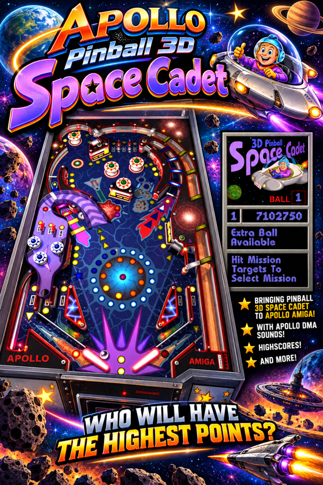

# #games — Week 41, 2026 (Oct 05 – Oct 11, 2026)

> **TL;DR** — Duke Nukem 3D and Wipeout feedback dominated: freezes on exit, missing music, and Wipeout controls and effects issues. Teasers appeared for paulthetallest's upcoming game and Samurai vs Ninja (Q1 2027), and Willem announced an ApolloCD32 live demo.

## Top topics

### Duke Nukem 3D port feedback: freeze on exit, no soundtrack, no gamepad
Users testing ZyBeR's Duke Nukem 3D port on Vampire hardware reported a frozen Workbench on exit and missing in-game music; ZyBeR could not test sound and asked others to try.

- reaperx2637 saw the freeze on V4SA with ApolloOS 9.6 RC05 and Core 12556_x13_09; realstar_1990 saw it on 12556E_x14_14.jic and OS 3.2.
- danyppc hears no soundtrack with FX and music on, F4 locked the game, and a 210MB duke3d.msc file is present.
- realstar_1990 also found no gamepad support.

❓ **Open:** Does the soundtrack work for anyone else? ZyBeR asked others to test.

🔗 [Apollo Computer downloads](https://www.apollo-computer.com/downloads.php)

_reaperx2637, danyppc, zyber.se, realstar_1990 · [jump →](https://discord.com/channels/726870908568076380/969942713560621157/1556478046540795925)_

### Wipeout on Vampire: controls fixed by deleting .save file, missing effects noted
Players praised Wipeout on Vampire, but realstar_1990's analog input failed until the .save file was deleted, and tommysammy noted missing transparency and light effects.

- realstar_1990 fixed constant left spin by deleting the .save file and restarting, since the config had got corrupted.
- tommysammy saw no transparency or light effects on shooting and shields, and hopes this is being worked on.

📎 [`glindtxt.MOV` (30.8 MB)](https://discord.com/channels/726870908568076380/969942713560621157/1556494753498136596)

_realstar_1990, tommysammy, aftonstjaerna · [jump →](https://discord.com/channels/726870908568076380/969942713560621157/1556494860964593748)_

### Upcoming game teasers from paulthetallest and Samurai vs Ninja (Q1 2027)
paulthetallest posted two teasers for a game to be released before year end, and _.cygnus._ announced Samurai vs Ninja for Q1 2027 with a teaser video.

- paulthetallest said everyone plays the sheriff in the game.
- paulthetallest also asked if people want an enhanced Apollo Angband version (4.2.6) with music and sound effects.

📎 [`SvN-teaser-full.mp4` (24.1 MB)](https://discord.com/channels/726870908568076380/969942713560621157/1558251502152196137)

_paulthetallest, _.cygnus._, tommo8871 · [jump →](https://discord.com/channels/726870908568076380/969942713560621157/1556883248699670650)_

## Also this week

- ApolloCD32 live demo announced in videoroom, with emulation questions · 🔗 [Discord message on ApolloCD32](https://discord.com/channels/726870908568076380/745290452198096957/1557122012823158924) · [jump →](https://discord.com/channels/726870908568076380/969942713560621157/1556980515725250572)
- Hardware sprite pointer support depends on core version; check core with ApolloControl CO · [jump →](https://discord.com/channels/726870908568076380/969942713560621157/1556480026629640316)
- rogue_particle shares Sushi Survivor game in development, asks for mechanics ideas · 🔗 [Sushi Survivor](https://youtu.be/VYlENsUWeWQ) · 🔗 [C64 Longplay - Tapper (HQ)](https://www.youtube.com/watch?v=74VPFoS18TU) · [jump →](https://discord.com/channels/726870908568076380/969942713560621157/1556657875114266716)
- Turbo Sprint by McGeezer and wishes for Vampire arcade conversions · 📎 [`super.mov` (19.9 MB)](https://discord.com/channels/726870908568076380/969942713560621157/1556564979468075020) · 🔗 [Turbo Sprint (Amiga AGA) by Geezer Games](https://mcgeezer.itch.io/turbo-sprint) · [jump →](https://discord.com/channels/726870908568076380/969942713560621157/1556575579959066704)

## Links

**Articles & videos**
- [Star Trek Judgement Rites (Amiga Interpreter)](https://www.indieretronews.com/2026/10/star-trek-judgement-rites-amiga.html) — Amiga interpreter release; roarfrow says it works on V4 via the exe. _(roarfrow)_

---
_Generated 2026-10-12 from 60 messages._
