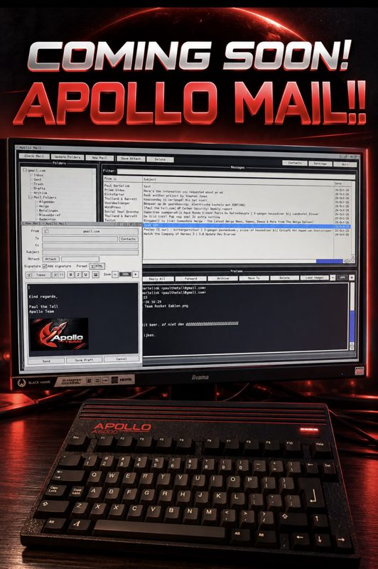

# #games — Week 44, 2026 (Oct 26 – Nov 01, 2026)

> **TL;DR** — A compiler-flag and pathfinding dispute over GemRB on Vampire escalated, and a separate thumbs-down on an email client release led to a member's removal and a heated debate on moderation and AI. Cego showed Age of Empires 2 and amaok WIP videos, and Hurrican and an Apollo email client were announced.

## Top topics

### Member removed after thumbs-down on email client release; community debates moderation and AI
After repeated thumbs-downs on others' work, biggun68080 announced a member's removal; cego1200, lord1976 and others asked for reconsideration while zyber.se and smaugur backed it, and the thread drifted into pro/anti-AI arguments.

- Messages in question were deleted, so many participants said they could not judge what was written.
- talchack urged settling disputes privately to avoid drama reaching other Amiga sites.
- olafsch. and eric_gustafson defended AI as a tool; thedaemonofid objected to the framing.

_biggun68080, cego1200, zyber.se, olafsch. · [jump →](https://discord.com/channels/726870908568076380/969942713560621157/1564996328554106881)_

### magicsn and biggun68080 clash over 080 compile flags; magicsn reviews Vampire support
magicsn said GemRB on Vampire is limited by pathfinding, not blitting or compiler version; biggun68080 argued 080 flags and AMMX generally help, and magicsn announced Vampire support is under review.

- biggun68080 cited team benchmarks (gzip, jpeg) with sometimes over 20% gain from 080 flags.
- magicsn said they spent 6 weeks optimizing and a separate 080 exe would give maybe 0.5 fps.
- cego1200 suggested decoupling pathfinding from rendering, as done in ZodEngine.

❓ **Open:** Whether magicsn continues Vampire support for future games.

_magicsn, biggun68080, other_pisklak, cego1200 · [jump →](https://discord.com/channels/726870908568076380/969942713560621157/1564190023665061889)_

### 📦 Apollo email client and Hurrican release plans announced
tommysammy said Hurrican will be released after 10 November at Vampire Lair; paulthetallest teased a multilingual email client with an HTML button, expected in November.

- The email client is heavily tested and has a Christmas theme.
- paulthetallest hinted at an Apollo office suite in the works.

_paulthetallest, tommysammy, thedaemonofid · [jump →](https://discord.com/channels/726870908568076380/969942713560621157/1564900703200346173)_

## Also this week

- cego1200 shows Age of Empires 2 and amaok WIP videos on V1200 · 🔗 [AOE2 - WIP 1 (V1200)](https://www.youtube.com/watch?v=5eBpPOKCM2E) · 🔗 [amaok - wip 1 (V1200)](https://www.youtube.com/watch?v=4DPVtq0HRFY) · [jump →](https://discord.com/channels/726870908568076380/969942713560621157/1564387716781842442)
- Ideas for enhancing Archon and Mail Order Monsters on Amiga · 🔗 [Archon Classic screenshots](https://www.mobygames.com/game/56077/archon-classic/screenshots/) · [jump →](https://discord.com/channels/726870908568076380/969942713560621157/1564331635531448422)
- zyber.se adds HD textures to Quake II, rewriting lighting to single pass · [jump →](https://discord.com/channels/726870908568076380/969942713560621157/1566516852052598784)
- tjomp reports AMMX speedups in masking routines · [jump →](https://discord.com/channels/726870908568076380/969942713560621157/1564198608683925556)

## Links

**Projects & releases**
- [MenuetOS](https://www.menuetos.net/) — Small OS on a floppy with 30+ apps. _(talchack)_
- [KolibriOS](https://www.kolibrios.org/en) — Spinoff of MenuetOS. _(talchack)_

**Articles & videos**
- [Day of the Tentacle article](https://www.indieretronews.com/2026/10/day-of-tentacle-famous-90s-adventure.html****) — Shared in joke about the new Day of the Tentacle port taking long to work. _(roarfrow)_

---
_Generated 2026-11-02 from 286 messages._
