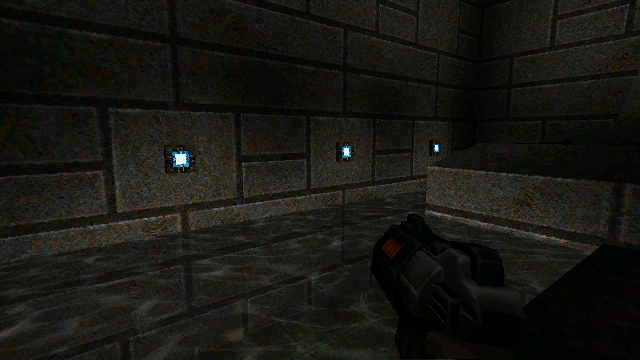
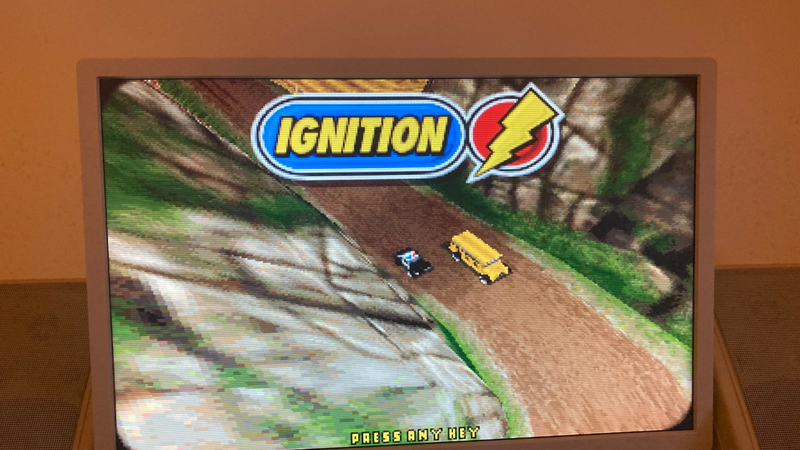

# #games — Week 45, 2026 (Nov 02 – Nov 08, 2026)

> **TL;DR** — zyber.se says Quake II HD textures are almost done. cego1200 teased a new port of Bleifuss Fun, and biggun68080 showed a Baldur's Gate build running with AMMX. Debate over Amiga port quality standards and Apollo gamepad support followed.

## Top topics

### zyber.se: Quake II HD textures almost done, screenshots shared
zyber.se posted new Quake II screenshots and said HD textures are almost done, following a lighting rewrite; the community responded very positively.

_zyber.se, tommo8871, kamelito · [jump →](https://discord.com/channels/726870908568076380/969942713560621157/1567674313279012926)_

### cego1200 announces new port of Bleifuss Fun, based on open-source reimplementation
cego1200 is making a new port, known in Germany as "Bleifuss Fun", based on a recently uploaded open-source reimplementation; Age of Empires 2 was requested but will take longer.

_cego1200, paulthetallest, olafsch. · [jump →](https://discord.com/channels/726870908568076380/969942713560621157/1567949758285217852)_

### Debate on minimum quality for Amiga ports: DMA audio, no AHI
biggun68080 argued that posted Amiga ports should meet quality minimums such as 16bit DMA audio and no AHI; danyppc and tommysammy agreed, and biggun68080 criticised ports claiming they cannot be done better.

- biggun68080 praised tommysammy's port as running excellently and Amiga-like, and tommysammy confirmed it uses DMA audio.
- danyppc had shared WipEout 2097 by Arcziii, hoping for a dedicated V4 version.

🔗 [WipEout 2097 by Arcziii](https://arcziii.itch.io/wipeout-2097)

_biggun68080, danyppc, tommysammy · [jump →](https://discord.com/channels/726870908568076380/969942713560621157/1569002337563840522)_

## Also this week

- Duke 3D port feedback: no music, crash on quit, Apollo gamepad request · [jump →](https://discord.com/channels/726870908568076380/969942713560621157/1568913427584385036)
- biggun68080 shows Baldur's Gate running with AMMX at 1024 HD, 60 FPS · [jump →](https://discord.com/channels/726870908568076380/969942713560621157/1568622185977741404)
- 📦 Worms Armageddon for Amiga shared by tommysammy · 🔗 [Worms Armageddon na Amigę](https://eterror.pl/worms/) · [jump →](https://discord.com/channels/726870908568076380/969942713560621157/1568914321700950026)

---
_Generated 2026-11-09 from 75 messages._
