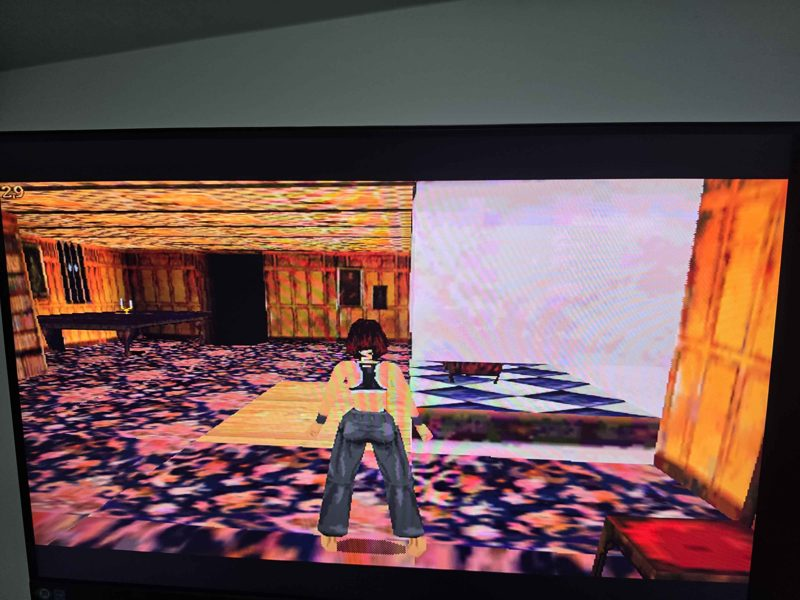

# #games — Week 46, 2026 (Nov 09 – Nov 15, 2026)

> **TL;DR** — Vampire/Apollo game work dominated: Hurrican port released, OpenLara freeze on V4 traced to the USB keyboard interrupt and patched, chips.c64 shared Maggie-based Pole Position and Blue Max ports, and xboxown4175 described a multi-platform game editor.

## Top topics

### OpenLara V4 freeze traced to AddKBInt USB keyboard hang; Maggie fork in progress
After mvk1993 reported OpenLara hanging on V1200, slaapliedje found the keyboard interrupt was the cause, patched it, and added bilinear filtering and basic Maggie support, planning a GitHub fork.

- Aminet 1.0.9.5b build and BSzili's source use lowlevel.library AddKBInt(); first USB key press hangs level-2 interrupts on V4SA.
- Fix reads keys as IDCMP_RAWKEY messages; tooltype KBINT=YES restores the old method.
- Amiga port is based on the GBA engine (no side-stepping); slaapliedje may switch to the PC engine bits with more GL acceleration.

❓ **Open:** Fork will be posted on GitHub; no link shared yet.

_slaapliedje, mvk1993, sheepsofrage, danyppc · [jump →](https://discord.com/channels/726870908568076380/969942713560621157/1570932611923312821)_

### 📦 chips.c64 releases Pole Position and Blue Max ports for Apollo Vampire
chips.c64 shared a Maggie-rendered port of the ppengine 3D Pole Position engine and a SAGA-only Blue Max port built from the Atari source, both made with AI help.

- Pole Position port built with claude and the Apollo Knowledgebase; controls via cursor keys or USB joypad.
- Blue Max needs Apollo 68080 with SAGA and a joystick in port 2; two versions, original and upgraded graphics/sound.
- slaapliedje started a claude skill based on this work.

📎 [`ppengine.lha` (1.3 MB)](https://discord.com/channels/726870908568076380/969942713560621157/1571494204348178472) · 📎 [`bluemax-apollo-hd` (1.3 MB)](https://discord.com/channels/726870908568076380/969942713560621157/1571541742514085979) · 📎 [`bluemax-apollo` (248 KB)](https://discord.com/channels/726870908568076380/969942713560621157/1571541742514085979) · 🔗 [GitHub - jonathanopalise/ppengine](https://github.com/jonathanopalise/ppengine) · 🔗 [GitHub - ApolloTeam-dev/ApolloKnowledgeBase](https://github.com/ApolloTeam-dev/ApolloKnowledgeBase) · 🔗 [GitHub - chipsc64/ppengine at ApolloAmiga](https://github.com/chipsc64/ppengine/tree/ApolloAmiga) · 🔗 [GitHub - chipsc64/ApolloBlueMax](https://github.com/chipsc64/ApolloBlueMax)

_chips.c64, slaapliedje · [jump →](https://discord.com/channels/726870908568076380/969942713560621157/1571494204348178472)_

### 📦 Hurrican port to Vampire V4 released by tommysammy
danyppc announced the Hurrican release and congratulated tommysammy on the port, praising its graphics and sound.

_danyppc, morten.dynamite, tommysammy · [jump →](https://discord.com/channels/726870908568076380/969942713560621157/1570821789569781861)_

## Also this week

- xboxown4175 describes multi-platform game editor targeting Vampire · [jump →](https://discord.com/channels/726870908568076380/969942713560621157/1571005688174608585)
- Tools for FTP, SSH and file transfer to a Vampire Amiga · [jump →](https://discord.com/channels/726870908568076380/969942713560621157/1570999868925943971)

## Links

**Articles & videos**
- [Sector4X Genesis XL - Amiga Trailer 1](https://www.youtube.com/watch?v=ODdlLO1wBks) — Trailer for a new Amiga space strategy game, shared as interesting. _(olafsch.)_
- [The Classic 3DFX logo (in HQ)](https://www.youtube.com/watch?v=_8UvDRc_rdo) — Suggested as a Voodoo splash for xboxown4175's splash request. _(sheepsofrage)_

**Other**
- [screenshot hosted at ImgBB](https://ibb.co/TMKPVwFv) — Screenshot of the editor targeting Vampire Amiga. _(xboxown4175)_
- [screenshot hosted at ImgBB](https://ibb.co/4wJqGMqg) — Screenshot of demo game made with the editor. _(xboxown4175)_

---
_Generated 2026-11-16 from 96 messages._
