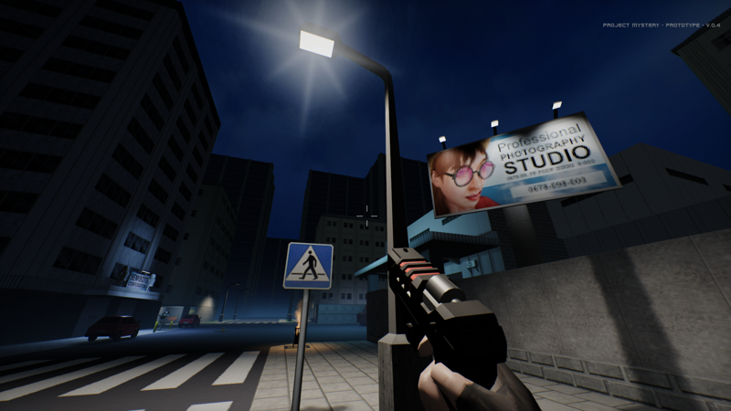

# #maggie3d — Week 43, 2026 (Oct 19 – Oct 25, 2026)

> **TL;DR** — vrimg clarified the relationship between Maggie3D and RMortenB's MaggieLibrary and got guidance on running the examples on a V4SA. ralph0789 asked whether a PS2-style lowpoly scene is feasible with Maggie.

## Top topics

### Maggie3D and MaggieLibrary are unrelated; version and V4SA setup clarified
vrimg couldn't get MaggieLibrary examples to show anything on a V4SA; rmortenb said the two libraries are unrelated and explained setup, and the repository build is the one to use.

- rmortenb: the examples need lowlevel.library, which AmiKit doesn't include, so they won't run there.
- Latest version is 4.0 (confirmed by tuko1548); vrimg should build from the repository rather than use the sagadrivers copy.
- lexo5016: Maggie3D is a simple triangle/quad lib; Morten's is more advanced with vertex buffers and transformation.

🔗 [GitHub - Lexodev/Maggie3D](https://github.com/Lexodev/Maggie3D) · 🔗 [GitHub - RMortenB/MaggieLibrary](https://github.com/RMortenB/MaggieLibrary)

_vrimg, rmortenb, kamelito, lexo5016 · [jump →](https://discord.com/channels/726870908568076380/941314613134381097/1562067428320608267)_

### Can Maggie render a PS2-style lowpoly street scene?
ralph0789 asked whether a lowpoly scene could be done with Maggie3d; replies doubted drawing the whole world at that resolution and frame rate, and rmortenb asked for scene data.

- zyber.se: whole world rendered at that resolution and frame rate is unlikely; 640x360 would need sacrifices.
- thellier_32275: possible if walls limit visibility, otherwise too many faces to clip and draw quickly.

❓ **Open:** ralph0789 is to share poly count and overdraw info so rmortenb can estimate frame rate.

_ralph0789, zyber.se, thellier_32275, rmortenb · [jump →](https://discord.com/channels/726870908568076380/941314613134381097/1563519655966932992)_

---
_Generated 2026-10-26 from 24 messages._
