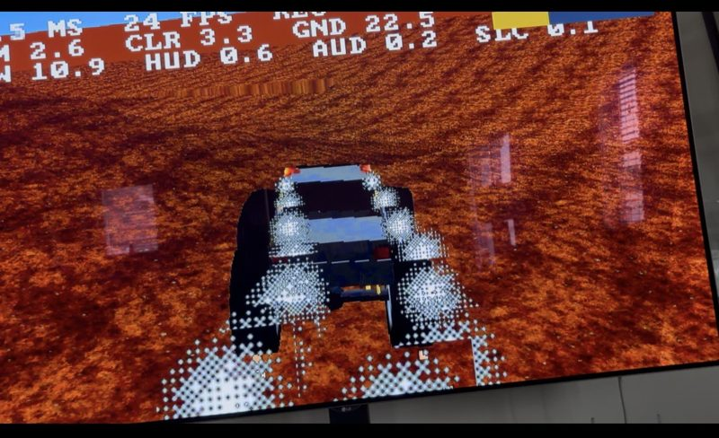

# #maggie3d — Week 47, 2026 (Nov 16 – Nov 22, 2026)

> **TL;DR** — nenarek found BLEND_ADD and BLEND_MUL drawing textured particle quads as solid boxes on the V4. biggun68080 said the next core is needed, and thellier_32275 explained how ADD/MUL behave; only DXT1 cutouts work for now.

## Top topics

### Maggie BLEND_ADD/BLEND_MUL draw solid boxes on V4; next core needed
nenarek's textured particle quads rendered as solid boxes with BLEND_ADD and BLEND_MUL on the V4, so they fell back to DXT1 cutouts. biggun68080 said the next core is required.

- thellier_32275 said ADD and MUL used to work with Maggie, though they don't know the Maggie.library usage.
- ADD saturates on pure white (255 255 255) and MUL does nothing on a white texture; a 50/50 smoke needs a texture around 128 128 128 for ADD.
- nenarek confirmed only cutouts work on the current core and will wait, since bigger Maggie changes are coming per Gunnar.

❓ **Open:** Whether blending works on all draw modes (sprites, affine, depth on) and per-texel alpha is available remains unanswered until the next core.

_nenarek, biggun68080, thellier_32275 · [jump →](https://discord.com/channels/726870908568076380/941314613134381097/1573801574357278781)_

---
_Generated 2026-11-23 from 7 messages._
