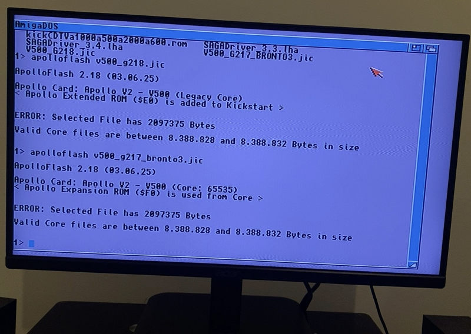

# #v2-series-legacy — Week 41, 2026 (Oct 05 – Oct 11, 2026)

> **TL;DR** — Vampire V2 owners asked about firmware and audio: ARNE audio and other features are V4-only, and retroinasia's flash from 2.16 to 2.18 left a black screen, likely needing a USB blaster to recover.

## Top topics

### Vampire V2 black screen after flashing 2.18; blaster needed to recover
retroinasia could not upgrade a V2 from 2.16 and, after flashing 2.18 with ApolloFlash 2.25, got a black screen on both RTG and CRT; r3dbug advised using a USB blaster.

- r3dbug: going 2.16 directly to 2.18 is normally fine; a bad flash is rare, and a blaster writes any .jic regardless of version.
- willemdrijver said ApolloFlash 2.22 and higher fixed the issue; the latest is 2.30.
- r3dbug said cards not registered by the vendor are stuck at 2.17; retroinasia remembers no registration.

❓ **Open:** retroinasia will retry with a blaster later; biggun68080 asked which country they are in.

📎 [`ApolloFlash` (58 KB)](https://discord.com/channels/726870908568076380/726871152848273418/1558101583701610587) · 🔗 [SAGADriver 3.5b21](http://apollo-core.com/RELEASE/SAGADriver_3.5b21.lha) · 🔗 [V500_G218.jic (V2 core 2.18)](https://apollo-computer.com/downloads/cores/v2apollovampire500/V500_G218.jic)

_retroinasia, r3dbug, willemdrijver, biggun68080 · [jump →](https://discord.com/channels/726870908568076380/726871152848273418/1558090355222651013)_

### ARNE audio and other features are V4-only, not on Vampire V2
malvarerj got lockups using AHI with ARNE on a V2; djbase and biggun68080 confirmed ARNE is exclusive to the V4 range.

- biggun68080 listed V4-exclusive features: 16bit audio/USB, 3D acceleration, high speed network, multilayer PIP, built-in flicker fixer, AGA.
- V4 cards also have a faster CPU, improved FPU and more memory.

_malvarerj, djbase, biggun68080 · [jump →](https://discord.com/channels/726870908568076380/726871152848273418/1556725564105162827)_

---
_Generated 2026-10-12 from 47 messages._
