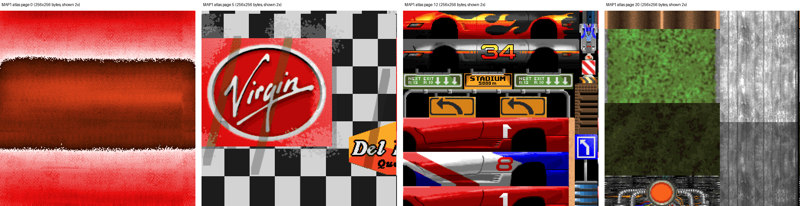

# #v2-series-legacy — Week 43, 2026 (Oct 19 – Oct 25, 2026)

> **TL;DR** — cego1200 is porting Screamer (1995) to the 68080 and got a tuning session from biggun68080 on texture layout, timing and the rasterizer loop. Screamer WIP 4 video shows 640x400 at 16-25fps and 320x200 above 25fps. biggun68080 previewed Strong Maggie and a new memory controller.

## Top topics

### biggun68080 reviews cego1200's Screamer 68080 port: cache, timing, rasterizer loop
cego1200 asked about V1200 cache sizes; biggun68080 then reviewed texture atlas layout, CIA timing and the inner texture loop, advising profiling with the CPU clock counter and left-to-right drawing.

- biggun68080 advised against CIA/eclock for fine-grained timing; use the CPU internal time counter, which is precise and cheap.
- Textures are packed in 256x256 atlas pages as in the 1995 DOS original; biggun68080 said unrelated textures sharing a page is bad for caching.
- cego1200's profiling shows the hot paths are instruction-bound, not cache-miss-bound; biggun68080 suggested `(A4)+` instead of `addq.l`, and a simpler loop running in 3 cycles.

🔗 [Screamer (1995) — How it runs on a 1994 retro PC (Pentium 90 Mhz)](https://www.youtube.com/watch?v=UG0RKNAIIv0&t=349s)

_biggun68080, cego1200 · [jump →](https://discord.com/channels/726870908568076380/726871152848273418/1562024495659622471)_

### 📦 Screamer WIP 4 video on V1200 shows music, asm optimizations and CD32 joypad
cego1200 shared the Screamer WIP 4 video running on V1200 at 640x400 and 320x200, which drew strong positive reactions; biggun68080 suggested increasing view distance by about 30%.

- WIP 4 adds music, more asm optimizations and cd32 joypad support.
- cego1200 would check whether the view distance can be changed; the DOS original behaved the same way.
- Others praised the work; apollonamiga asked whether Bleifuss 2 comes next.

🔗 [Screamer WIP 4 (V1200)](https://www.youtube.com/watch?v=aX28plAz85g)

_cego1200, biggun68080, apollonamiga · [jump →](https://discord.com/channels/726870908568076380/726871152848273418/1562071741130342410)_

### biggun68080 previews Strong Maggie, 128-bit memory controller and new core
biggun68080 described upcoming Vampire features: Maggie V2 about 3 times faster with fog, a 128-bit memory controller, and a 128-bit AMMX upgrade, with a new core release hoped for the next day.

- The memory controller gives 1.6 GByte/s at 100MHz.
- Maggie does bilinear filtering and texture rasterlines in parallel to the CPU.
- A Strong Maggie core is planned a few days after the new release.

❓ **Open:** New core release was hoped for the next day; Strong Maggie core to follow.

_biggun68080, cego1200 · [jump →](https://discord.com/channels/726870908568076380/726871152848273418/1562061180753805444)_

---
_Generated 2026-10-26 from 278 messages._
