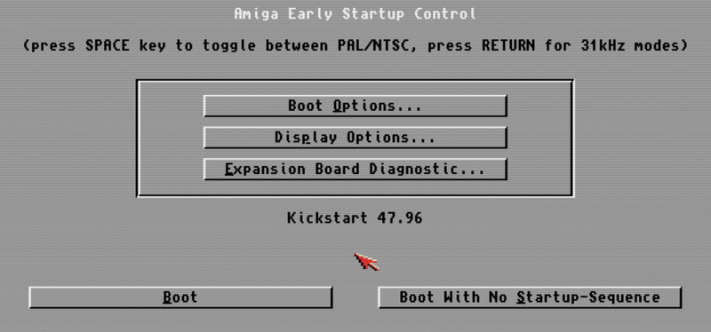
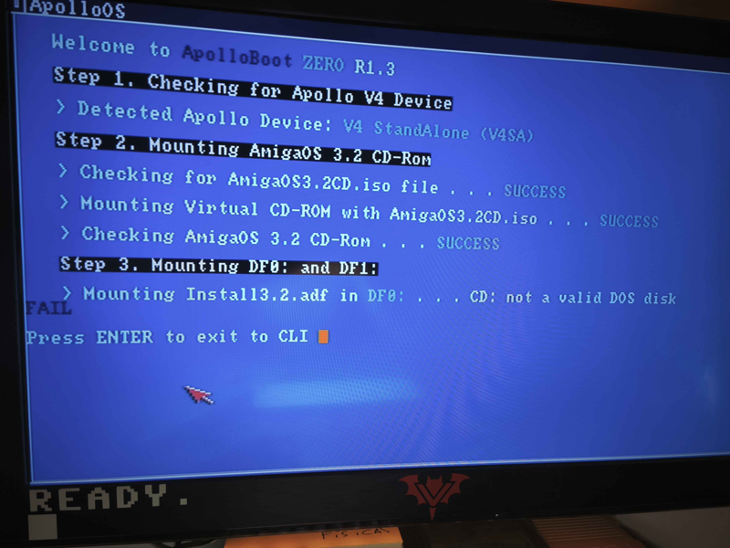

# #v4-series-the-best — Week 42, 2026 (Oct 12 – Oct 18, 2026)

> **TL;DR** — Newcomers struggled with V4 setup: maia75000 spent days on OMNI/AmiKit and ApolloBoot Zero errors, while amigoray's V4SA failed to boot OMNI on core 11350. Bartos81 shared an ICEDRAKE core with flashing steps; ApolloBoot access via Vampire Lair subscription was explained.

## Top topics

### maia75000 troubleshoots OMNI, AmiKit and AmigaOS 3.2.3 boot problems on new V4
maia75000 struggled with AmiKit's missing Early Startup submenu and a greyed 3.2.3 Workbench; tim3233 guided them to the early boot menu via both mouse buttons, which finally worked after re-adding the ROM.

- Two early boot menus exist: ApolloROM and Amiga Kickstart; hold both mouse buttons after ApolloROM's message to reach the Amiga one to untick 'Update ROM Modules'.
- maia75000 runs ApolloBoot-OMNI-R92-P5 with core 12556; tim3233 said that is current and core shouldn't be the issue.
- 3.2.3 still doesn't boot properly and a wrong ROM gave a red screen; tim3233 couldn't say which ROM version 3.2.3 needs.

❓ **Open:** 3.2.3 still fails to boot properly and the correct ROM for AmiKit with 3.2.3 is unknown.

📎 [`20261016_193403.mp4` (14.2 MB)](https://discord.com/channels/726870908568076380/726871100243312650/1560708041488470217)

_maia75000, tim3233, aftonstjaerna · [jump →](https://discord.com/channels/726870908568076380/726871100243312650/1560702122851303447)_

### ApolloBoot Zero fails on maia75000's V4 with several SD and CF cards
maia75000 became a Silver member to request a PRELOAD and hit the same error with ApolloBoot Zero on multiple cards; others suggested coffin65 on a CF card, a faulty card or adapter.

- aftonstjaerna recommended writing coffin65 to a CF card as plug-and-play while waiting for the preload.
- hansolo9190 suspects the Kingston CF card and uses Sandisk; sheepsofrage says an intermediary SD adapter broke a bootable write for them.
- ApolloBoot Zero is just install scripts with no ApolloBoot menu, so IDE speed can't be lowered there.

❓ **Open:** maia75000 is waiting for Willem to return from holiday for help.

_maia75000, hansolo9190, aftonstjaerna, sheepsofrage · [jump →](https://discord.com/channels/726870908568076380/726871100243312650/1561027085903073382)_

### V4SA fails to boot OMNI after updating to core 11350; ApolloBoot update advised
amigoray's V4SA showed the boot animation then a black screen on core 11350.jic with OMNI, working on 10000.jic; tim3233 suggested updating ApolloBoot, which requires a Vampire Lair subscription.

- tim3233 said newer cores can need a newer ApolloBoot and doubts speed is the cause since Coffin runs.
- ApolloBoot downloads are free but need at least one month of Vampire Lair on ko-fi, cancellable anytime.

🔗 [Support Apollo Vampire Lair](https://ko-fi.com/apollovampirelair)

_amigoray, tim3233, talchack, willemdrijver · [jump →](https://discord.com/channels/726870908568076380/726871100243312650/1559194304633638943)_

## Also this week

- ICEDRAKE core 12781 flashing steps and WHDLoad problems · 🔗 [ICEDRAKE_12781_x14_17.jic core](http://www.apollo-core.com/ALPHA/ICEDRAKE_12781_x14_17.jic) · [jump →](https://discord.com/channels/726870908568076380/726871100243312650/1560380953023484054)
- Apollo keyboards are German layout; A6000 ships with US keyboard · [jump →](https://discord.com/channels/726870908568076380/726871100243312650/1560364114562519153)
- apollo-core.com forum menu redirects to a 404 page · 🔗 [APOLLO CPU Knowledge Forum](http://www.apollo-core.com/knwledge.php) · [jump →](https://discord.com/channels/726870908568076380/726871100243312650/1559296398409736283)
- amigoray asks how to make a bootable SD with AOS3.0 and older KS ROM · [jump →](https://discord.com/channels/726870908568076380/726871100243312650/1561371492069941401)

---
_Generated 2026-10-19 from 127 messages._
