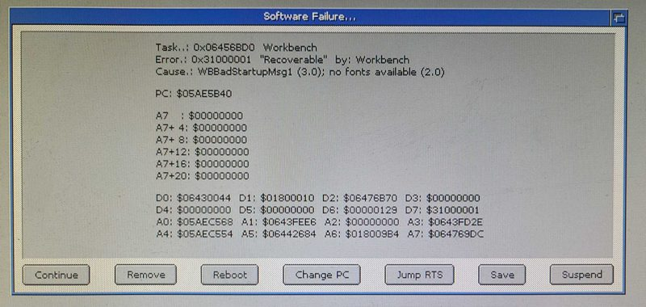

# #v4-series-the-best — Week 46, 2026 (Nov 09 – Nov 15, 2026)

> **TL;DR** — rod_cl found IceDrake V4 core 11385 (ApolloROM 9.5) no longer detects their CF card, while older cores work; lord1976 suggested core 12207. asktodd's V4 stopped booting after the XSysInfo installer, and slaapliedje reported a USB pad bug on core 12846.

## Top topics

### IceDrake V4 core 11385 no longer detects CF/IDE; older cores work
rod_cl lost ata.device after flashing core 11385 on an IceDrake V4 Rev 4; cores 9663 and 9234 detect the CF again, so rod_cl stays on 9234. lord1976 suggested core 12207.

- Tried two CF cards, both IDE headers and all adapter jumper settings; the microSD with Coffin r65 works.
- arcam10 advised updating SAGA drivers; rod_cl noted the CF was already missing in ApolloROM Boot Options before any mapping.
- lord1976 runs ICEDRAKE_12207_x14_13f.jic stably on a 100MHz IceDrake with 1024MB RAM.

❓ **Open:** Whether ApolloROM 9.5's IDE probe is the cause, and whether 12207 or R9.6-RC06 fixes it, is untested.

📎 [`ICEDRAKE_12207_x14_13f.jic` (8.0 MB)](https://discord.com/channels/726870908568076380/726871100243312650/1570010083625279528)

_rod_cl, arcam10, lord1976 · [jump →](https://discord.com/channels/726870908568076380/726871100243312650/1569194956315172886)_

### V4 fails to boot after running XSysInfo installer; recovery options discussed
asktodd's V4 stopped booting after running the XSysInfo installer; booting without startup-sequence reaches the CLI. Others suggested reflashing the Coffin image to the CF card.

- sheepsofrage suggested holding both mouse buttons at power-on to bypass startup-sequence, and suspected the installer altered startup files.
- morten.dynamite recommended re-burning the OS image with BalenaEtcher; monos_36960 noted Balena can write zipped images directly.

❓ **Open:** asktodd may post the startup-sequence to find what broke; no fix confirmed.

_asktodd, sheepsofrage, morten.dynamite, monos_36960 · [jump →](https://discord.com/channels/726870908568076380/726871100243312650/1570527023758184601)_

### Vampire USB pad on core 12846 reads as Select held
slaapliedje reported that on core 12846 the USB pad's $DFF220 reads $5001 at rest, so the right trigger alone enters HRTmon; 'D' mode made it work.

- Right trigger analog value appears in bits 1–8 (5001 → 51FF).

_slaapliedje · [jump →](https://discord.com/channels/726870908568076380/726871100243312650/1571424523356741653)_

## Also this week

- Amiga AI-assisted ports: zyber.se makes them, kamelito notes many exist · [jump →](https://discord.com/channels/726870908568076380/726871100243312650/1571622490747310141)

## Links

**Projects & releases**
- [Apollo Vampire Lair](https://apollo-vampire-lair.com) — Pointed to for new releases announced in #announcements. _(willemdrijver)_

---
_Generated 2026-11-16 from 25 messages._
